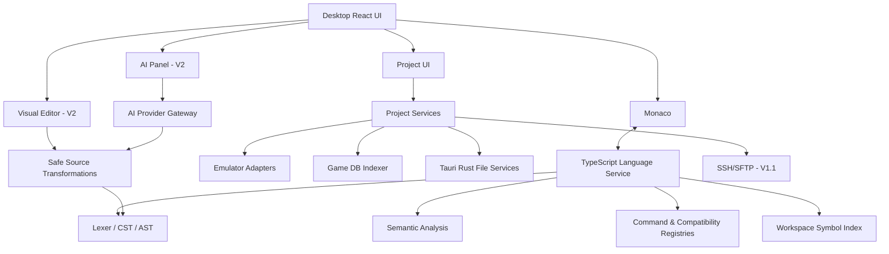

# CLAUDE.md — RuneForge Studio

> **Document directeur pour Claude Code**  
> **Projet :** RuneForge Studio (nom de travail, à valider commercialement)  
> **Version de cette spécification :** 1.0  
> **Langue du produit :** français et anglais  
> **Dernière révision :** 2026-11-05  
> **Statut :** spécification et plan d'exécution — **aucune fonctionnalité n'est présumée déjà implémentée**.

---

## 0. Instructions impératives à Claude Code

Tu agis comme **architecte logiciel principal, développeur senior full-stack TypeScript/Rust, spécialiste des IDE et des outils de langage (parser, CST/AST, LSP), responsable qualité et sécurité**.

Ta mission est de **concevoir puis construire progressivement** RuneForge Studio, une application desktop commerciale permettant de développer des scripts pour les émulateurs **rAthena et Hercules** de Ragnarok Online, sur **Windows et Linux**.

### Règles de travail non négociables

1. **Implémenter, ne pas seulement conseiller.** À chaque session, examiner le dépôt, identifier le prochain livrable vérifiable et réaliser des modifications concrètes si l'environnement de travail le permet.
2. **Ne rien présumer de l'état du dépôt.** Examiner les fichiers, les scripts de build et les tests avant toute modification. Ne jamais présenter une idée, une maquette ou un code non exécuté comme une fonctionnalité livrée.
3. **Avancer par jalons verticaux courts.** Une interface minimale utilisable avec un test automatisé vaut mieux que dix modules vides.
4. **La V1 est un IDE de code intelligent.** Ne pas sacrifier le parser, l'autocomplétion, la sauvegarde fiable ou la compatibilité Windows/Linux pour développer prématurément l'éditeur visuel, la simulation ou l'IA.
5. **Le code source utilisateur est sacré.** Aucun import, formatage, analyse ou transformation ne doit entraîner de perte silencieuse de texte, de commentaires, de tabulations, d'encodage, de fins de ligne ou de constructions inconnues.
6. **Respecter les différences rAthena/Hercules.** Ne pas inventer d'équivalence. Chaque commande et fonction doit être associée à des sources et, lorsque disponible, à une version/révision de référence.
7. **Ne jamais considérer une analyse statique comme une exécution serveur.** Les validations locales sont informatives ; seul le serveur cible peut confirmer son comportement effectif.
8. **Sécurité par défaut.** Aucune exécution de scripts, commande shell distante, connexion réseau, téléchargement, télémétrie, accès IA cloud ou déploiement sans action explicite de l'utilisateur.
9. **Respect des licences et de l'attribution.** Ne pas intégrer de ressources graphiques Ragnarok ni de fichiers propriétaires sans autorisation. La bibliothèque de scripting rAthena intégrée est distribuée sous GPL-3.0-only avec le produit ; conserver sa licence et ses références de provenance.
10. **Tester les changements.** Après une modification : exécuter les tests pertinents, vérifier les types et le lint. Indiquer honnêtement ce qui n'a pas pu être testé et pourquoi.
11. **Documentation vivante.** Tenir à jour `docs/STATUS.md`, `docs/DECISIONS.md`, les tests, les interfaces publiques et le backlog. Garder la traçabilité exigences → implémentation → tests.
12. **Priorité à la simplicité maintenable.** Pas de microservices, backend SaaS, conteneurs obligatoires, bus d'événements distribués, système de plugins exécutables ou abstractions sans besoin prouvé en V1.
13. **Si une décision est insuffisamment documentée**, choisir une solution conservatrice, la documenter comme hypothèse et avancer sans bloquer un jalon. Demander confirmation uniquement pour un choix irréversible ou concernant les droits, les paiements, la production ou une opération destructive.
14. **Ne pas effectuer de commit ni de push** sans instruction explicite du propriétaire du dépôt, sauf si ses consignes locales autorisent clairement cette action.
15. **Toujours terminer une session** par : éléments modifiés, commandes/tests exécutés et leurs résultats, limites restantes, et prochain petit jalon recommandé.

### Ordre de priorité permanent

**Fiabilité des fichiers > correction syntaxique > compatibilité des émulateurs > intelligence de l'éditeur > performance > ergonomie > édition visuelle > IA > monétisation avancée.**

---

# 1. Vision du produit

## 1.1 Proposition de valeur

RuneForge Studio est un **environnement de développement intégré (IDE) spécialisé dans Ragnarok Online**, accessible aux débutants et suffisamment puissant pour les scripteurs professionnels.

Le produit réunit, progressivement :

- **Éditeur de code intelligent** avec coloration, autocomplétion contextuelle, documentation, navigation, refactoring et diagnostics.
- **Assistants de génération** de NPC : warp, shop, healer, buffer, quest giver, event manager, etc.
- **Éditeur visuel drag-and-drop** avec nœuds, conditions, actions, branchements et blocs personnalisés.
- **Importation de scripts existants** avec conversion en graphes lorsqu'elle est sûre, et conservation du code non convertible.
- **Explorateurs de données serveur** : cartes, items, monstres, constantes, NPC, fonctions et quêtes.
- **Simulation progressive** : dialogues et logique, prévisualisation graphique optionnelle, puis validation contre un vrai serveur de test.
- **Déploiement local, export, SSH/SFTP et Git** avec contrôles de sécurité.
- **Assistance IA facultative**, locale (ex. service sur NVIDIA DGX Spark via une API compatible) et cloud sur consentement explicite.
- **Windows + Linux** avec installation, mise à jour et politique de licence commerciale.

## 1.2 Public cible

| Persona | Besoin prioritaire | Expérience attendue |
|---|---|---|
| Débutant | Créer des NPC sans connaître le langage | Assistant guidé, modèles, explications et erreurs compréhensibles |
| Scripteur confirmé | Programmer rapidement | Monaco, snippets, symboles, références, autocomplétion |
| Administrateur de serveur | Modifier du contenu existant | Ouverture de projet, profils, diagnostics, sauvegardes et export |
| Équipe de développement | Maintenir plusieurs scripts/projets | Git, validation, indexation, compatibilité et déploiement contrôlé |
| Créateur de contenu avancé | Produire quêtes, instances et systèmes originaux | Nœuds + code personnalisé + fonctions réutilisables |

## 1.3 Principes UX

- Les débutants ne doivent pas être confrontés d'emblée aux détails du langage.
- Les utilisateurs avancés doivent pouvoir accéder immédiatement au code intégral.
- Le projet reste utilisable intégralement **hors ligne** pour ses fonctionnalités essentielles.
- Les messages d'erreur doivent expliquer **quoi, où, pourquoi et comment corriger**.
- L'interface doit pouvoir afficher le **profil d'émulateur actif** et le niveau de confiance de chaque diagnostic.
- L'application ne doit jamais prétendre qu'un script fonctionne sur le serveur si celui-ci n'a pas été testé sur un serveur de référence.

---

# 2. Portée et plan de versions

## 2.1 V1.0 — Smart Script IDE (priorité absolue)

**Inclus en V1 :**

1. Application desktop Tauri fonctionnelle sur Windows et Linux.
2. Fenêtre principale avec panneaux redimensionnables, explorer, onglets, barre de statut et préférences.
3. Ouverture, création, modification, recherche et sauvegarde fiable de scripts `.txt`.
4. Gestion de projets autonomes et dossiers de serveurs locaux.
5. Détection configurable de rAthena ou Hercules ; profil explicite et version/révision facultative.
6. Monaco Editor : coloration syntaxique, indentation, appariement des délimiteurs, snippets et raccourcis.
7. Lexer et parser tolérants aux erreurs, avec plages de source et conservation des éléments lexicaux.
8. Registre de commandes, définitions et documentation versionnés par émulateur.
9. Autocomplétion contextuelle, documentation au survol et aide des signatures.
10. Diagnostics de syntaxe et premières vérifications sémantiques, y compris les labels/fonctions connus.
11. Indexation de symboles dans un projet, navigation et recherche.
12. Recherche et insertion de références dans les bases de données (initialement un sous-ensemble utile : items, monstres, cartes et constantes).
13. Configuration de commandes et constantes personnalisées.
14. Modèles/snippets de NPC standards (au minimum script NPC, warp, shop et healer).
15. Diff des fichiers modifiés, récupération des fichiers non enregistrés et sauvegardes.
16. Tests automatisés, documentation utilisateur, distributions, journalisation locale opt-in pour diagnostic.

**Hors V1 et interdits comme dépendances bloquantes :** éditeur visuel général, simulateur 2D, boutique de plugins, infrastructure cloud, IA obligatoire, déploiement automatique en production.

## 2.2 V1.1 — Assistants et intégrations

- Wizards de NPC plus riches avec validation et prévisualisation du code.
- Git : statut, diff et ouverture du dépôt (sans tenter de remplacer un client Git complet).
- SFTP/SSH avec connexion explicite, sauvegarde, dry-run et transfert contrôlé.
- Diagnostics issus d'un environnement de test configuré par l'utilisateur.
- Raffinement du formatter et des refactorings qui ne touchent pas au code non reconnu.
- Possibilité d'un premier assistant IA **optionnel** si le socle est suffisamment robuste.

## 2.3 V2 — Construction visuelle

- Graphe de nœuds avec catégorisation et palette de blocs.
- Éditeur de dialogues, embranchements, conditions et récompenses.
- Sérialisation d'un graphe en représentation intermédiaire puis en source.
- Import d'un script vers un graphe lorsque la conversion est fiable ; sinon mode hybride ou code seul.
- Blocs `Raw Script` pour les constructions non représentables.
- Visualisation des différences avant toute transformation.
- Simulateur **limité et clairement identifié** des dialogues et flux simples.
- IA locale/cloud optionnelle avec aperçu des changements.

## 2.4 V3+ — Studio avancé

- Simulation plus complète, états de joueurs et inventaire de test.
- Prévisualisation graphique utilisant uniquement des ressources autorisées et fournies légalement.
- Environnement de validation avec vrai serveur de test isolé.
- SDK de plugins versionné, extensions spécialisées et éventuelle marketplace.
- Déploiement plus avancé, stratégies par environnement et rollback.
- Collaboration et fonctionnalités commerciales avancées après validation de la demande.

---

# 3. Exigences fonctionnelles et critères d'acceptation

Les identifiants d'exigences doivent être repris dans les issues, tickets, tests et notes de release.

| ID | Exigence | Phase | Critère de réception principal |
|---|---|---|---|
| RF-001 | Ouvrir un dossier de projet | V1 | Le dossier s'affiche sans modifier ses fichiers |
| RF-002 | Gestion des onglets et documents | V1 | Plusieurs `.txt` peuvent être modifiés sans perte |
| RF-003 | Sauvegarde fiable | V1 | Le format et le contenu sont conservés lorsque non modifiés |
| RF-004 | Monaco et coloration | V1 | Les éléments linguistiques connus sont distingués |
| RF-005 | Lexer/parser tolérant | V1 | Parsing partiel possible sur un fichier incomplet |
| RF-006 | Autocomplétion | V1 | Suggestions adaptées au contexte et au profil |
| RF-007 | Hover/signatures | V1 | Informations sur une commande documentée |
| RF-008 | Diagnostics | V1 | Erreurs situées précisément avec niveau de sévérité |
| RF-009 | Symboles et références | V1 | Navigation entre fonctions, NPC et labels connus |
| RF-010 | Registres rAthena/Hercules | V1 | Choisir l'émulateur modifie les catalogues et alertes |
| RF-011 | Extension des commandes | V1 | Commande personnalisée déclarable sans patch moteur |
| RF-012 | Index d'items/monstres/cartes | V1 | Recherche réactive et insertion de références |
| RF-013 | Modèles simples | V1 | Création de NPC script/warp/shop/healer valide pour profil testé |
| RF-014 | Préservation des sources | V1 | Ouvrir/enregistrer sans changement est byte-identical lorsque possible |
| RF-015 | Diagnostic de projet | V1 | Validation multi-fichiers avec rapport exploitable |
| RF-016 | Journal local et récupération | V1 | Document non sauvegardé récupérable après crash contrôlé |
| RF-017 | Wizard de NPC guidé | V1.1 | Formulaire → script → validation → aperçu |
| RF-018 | SSH/SFTP | V1.1 | Test de connexion, diff, sauvegarde, transfert explicite |
| RF-019 | Git et fichiers modifiés | V1.1 | Statut et comparaison lisibles |
| RF-020 | Éditeur de graphe | V2 | Créer et connecter des nœuds compatibles |
| RF-021 | Génération visuel → code | V2 | Production déterministe et revalidation |
| RF-022 | Conversion code → visuel | V2 | Conversion partielle signalée sans perte de code |
| RF-023 | Bloc de code brut | V2 | Code inconnu préservé sans réécriture silencieuse |
| RF-024 | Simulation de dialogues | V2 | Scénarios de test simples, avec limites visibles |
| RF-025 | IA locale et cloud | V2 | Aucune donnée envoyée sans autorisation ; diff proposé |
| RF-026 | Test serveur réel | V3 | Exécution sur environnement explicitement isolé |
| RF-027 | Système de plugins | V3 | API versionnée, permissions et isolation |

### Exemples de parcours utilisateurs vérifiables

**A — Nouveau scripteur :** crée un projet rAthena → choisit le modèle warp → renseigne la destination → obtient un `.txt` standard → voit les erreurs avant l'export.

**B — Développeur expérimenté :** ouvre 2 000 fichiers → retrouve une fonction via recherche → consulte la signature de `callfunc` → modifie le script → visualise le diff → sauvegarde sans changer les autres fichiers.

**C — Fork personnalisé :** déclare une commande custom → celle-ci apparaît dans l'autocomplétion avec une signature → n'est plus signalée comme inconnue → reste marquée « définition personnalisée ».

**D — Import visuel futur :** ouvre un NPC contenant des instructions non prises en charge → l'outil affiche les sections convertibles et non convertibles → modification visuelle → diff limité → aucun fragment inconnu perdu.

---

# 4. Exigences non fonctionnelles

Les valeurs ci-dessous sont des **cibles de mesure**, pas des performances déjà prouvées.

| Domaine | Cible |
|---|---|
| Démarrage | Application utilisable en < 3 s sur machine de référence définie |
| Suggestions | Réponse habituelle < 100 ms sur fichier déjà indexé |
| Saisie | Pas de blocage perceptible pendant les analyses longues |
| Projet | Indexer au minimum 5 000 scripts sur une machine de référence |
| Gros fichiers | Supporter des fichiers de plusieurs milliers de lignes |
| Sauvegarde | Aucun changement involontaire de BOM, encodage et CRLF/LF |
| Hors ligne | IDE, docs intégrées, analyse et index locaux fonctionnels |
| Résilience | Récupération des modifications non sauvegardées |
| Sécurité | Privilèges minimums et accès réseau désactivé par défaut |
| Langues | UI FR/EN et contenu technique traduit selon disponibilité |
| Accessibilité | Raccourcis clavier, focus visible, panneaux redimensionnables |
| Logs | Aucun secret, chemin sensible ou source complet par défaut |
| Distribution | Windows et Linux testés en CI + validation manuelle |

Définir un environnement de benchmark reproductible dans `docs/PERFORMANCE.md` ; ne pas optimiser prématurément sans traces et mesures.

---

# 5. Architecture technique retenue

## 5.1 Technologies

| Zone | Choix | Notes |
|---|---|---|
| Desktop | **Tauri 2 + Rust** | Capabilities restrictives, API système sécurisée |
| Frontend | **React + TypeScript + Vite** | TypeScript strict |
| UI | Composants accessibles et design system interne | Ne pas verrouiller trop tôt une bibliothèque spécifique |
| Code editor | **Monaco Editor** | Éditeur central V1 |
| Language service | **LSP en TypeScript** | Worker local initial, possibilité d'adaptateur CLI |
| Lexer/parser | **TypeScript**, parser spécialisé | CST lossless + AST sémantique |
| App state | État typé, composants découplés | Petite librairie de state si nécessaire, pas d'architecture excessive |
| Recherche/index | Mémoire + SQLite/FTS5 | Intégration locale via services Tauri ; mesurer les performances |
| Visuel V2 | **React Flow** | Vérifier licences et APIs installées |
| IA V2 | Gateway `AIProvider` | HTTP local/OpenAI-compatible + adaptateurs cloud facultatifs |
| Connexions | Rust Tauri | SSH/SFTP, gestion des clés, secrets OS |
| Builds | pnpm + Cargo + CI Windows/Linux | Versions verrouillées dans les lockfiles |
| Tests | Vitest + tests Rust + tests UI/E2E | Choisir outils E2E selon faisabilité Tauri |
| Licence produit | Service isolé et facultatif à l'exécution IDE | Pas de télémétrie ou vérification cloud permanente |

**Versions :** utiliser les versions stables compatibles vérifiées au moment de l'installation, les enregistrer dans les manifestes et lockfiles. Éviter d'inventer des numéros de versions et de supposer que les APIs n'ont pas changé.

### Particularités des plateformes

- Windows utilise WebView2 dans Tauri ; Linux utilise WebKitGTK. Tester réellement les deux moteurs : comportements clavier, Monaco, IME, haute résolution, copier/coller, raccourcis et fichiers volumineux.
- Ne pas supposer qu'un `.exe` Windows peut être construit et validé entièrement depuis Linux sans configuration spécifique.
- Ne pas promettre d'AppImage, `.deb`, `.rpm` et installateur Windows sans tester les prérequis de chaque format.

## 5.2 Diagramme logique



## 5.3 Principales frontières architecturales

- **UI** ne sait pas parser le langage : elle appelle le service de langage.
- **Language Engine** ne dépend ni de React, ni de Monaco, ni de Tauri, ni de systèmes de fichiers OS.
- **Emulator Adapter** fournit catalogue, règles de compatibilité, sources de données et règles de chargement ; pas de composant UI.
- **Project Services** décident quoi indexer et comment résoudre les fichiers du projet.
- **Rust/Tauri** effectue opérations privilégiées, validation des chemins, sauvegarde, stockage sécurisé et connexions.
- **AI** produit des propositions textuelles ou structurées ; seul le pipeline de transformations, de validation, de diff et d'approbation peut les appliquer.
- **Visual Editor** ne modifie jamais directement les fichiers ; il appelle des opérations de patch et vérifie la version du document.

## 5.4 Monorepo proposé

```text
runeforge-studio/
├── CLAUDE.md
├── README.md
├── pnpm-workspace.yaml
├── pnpm-lock.yaml
├── package.json
├── Cargo.toml                         # workspace si crates supplémentaires
├── apps/
│   └── desktop/
│       ├── package.json
│       ├── vite.config.ts
│       ├── src/
│       │   ├── app/
│       │   ├── features/
│       │   │   ├── workspace/
│       │   │   ├── editor/
│       │   │   ├── diagnostics/
│       │   │   ├── catalog/
│       │   │   ├── settings/
│       │   │   └── templates/
│       │   ├── components/
│       │   ├── hooks/
│       │   ├── services/
│       │   └── styles/
│       └── src-tauri/
│           ├── Cargo.toml
│           ├── capabilities/
│           ├── icons/
│           └── src/
├── packages/
│   ├── runescript-core/                # types, tokens, AST/CST de base
│   ├── runescript-parser/              # parser et récupération d'erreurs
│   ├── runescript-analysis/            # scopes, résolutions, diagnostics
│   ├── runescript-language-server/     # implémentation LSP
│   ├── runescript-formatter/           # ajouts ultérieurs sûrs
│   ├── emulator-core/                  # profils, interfaces et registres
│   ├── emulator-rathena/
│   ├── emulator-hercules/
│   ├── project-core/
│   ├── database-indexer/
│   ├── npc-templates/
│   ├── visual-core/                    # V2, sans dépendance UI
│   ├── visual-editor/                  # V2
│   ├── ai-core/                        # V2
│   ├── plugin-sdk/                     # V3
│   ├── shared-types/
│   └── ui/
├── crates/
│   ├── file-services/                 # lorsque nécessaire
│   ├── remote-transport/              # V1.1
│   └── secure-storage/                # lorsque nécessaire
├── tests/
│   ├── fixtures/
│   ├── parser-corpus/
│   ├── compatibility/
│   ├── integration/
│   └── e2e/
├── docs/
│   ├── STATUS.md
│   ├── DECISIONS.md
│   ├── ARCHITECTURE.md
│   ├── LANGUAGE_SPEC.md
│   ├── COMPATIBILITY.md
│   ├── SECURITY.md
│   ├── PERFORMANCE.md
│   ├── RELEASE.md
│   └── ROADMAP.md
└── scripts/
```

**Important :** cette arborescence est une cible, **pas** une instruction de créer toutes les coquilles de paquets le premier jour. Créer les packages lorsqu'un jalon en a un usage réel.

---

# 6. Noyau RuneScript : exigences de parsing

## 6.1 Ne pas confondre le langage Ragnarok et le langage C

Les scripts rAthena/Hercules possèdent une syntaxe particulière :

- déclarations de premier niveau souvent **séparées par des tabulations** et pouvant débuter par une carte, `-`, `function`, etc. ;
- variantes `script`, `warp`, `shop`, `cashshop`, `itemshop`, `pointshop`, `marketshop`, monstres, `mapflag`, fonctions, NPC flottants et autres variantes réellement présentes dans la version ciblée ;
- corps d'instructions en `{ ... }`, labels (`OnInit:`, `OnTouch:` et labels arbitraires), événements et fonctions ;
- commandes avec syntaxe instruction (`mes "Bonjour";`, `set .@x, 1;`) et expressions/fonctions avec parenthèses (`getitemname(501)`) ;
- chaînes, échappements, commentaires, opérateurs, indices de tableau et expressions conditionnelles ;
- variables avec préfixes et suffixes significatifs : `.@`, `.`, `@`, `$`, `$@`, `#`, `##`, `'`, suffixe `$`, et cas propres aux versions ;
- références à des commandes spécifiques au moteur, à des fonctions personnalisées et à des objets externes.

Ne **jamais** remplacer le parser par un parseur C/JavaScript ni rechercher les structures uniquement avec des expressions régulières.

## 6.2 Pipeline

```text
Raw bytes
  │
  ├─> Encoding / BOM / EOL detection
  ▼
SourceDocument + offsets
  │
  ▼
Lexer (tokens + trivia + source ranges)
  │
  ▼
CST tolérant aux erreurs, avec nœuds inconnus
  │
  ▼
AST (déclarations / instructions / expressions)
  │
  ▼
Symbol tables + scopes + cross-file reference index
  │
  ├─> Diagnostics
  ├─> Completion / Hover / Signature Help / Navigation
  ├─> Compatibility checks
  ├─> Safe code actions
  └─> Visual IR / transformations (V2)
```

### Invariants

- Tokenisation déterministe et testable indépendamment.
- Chaque token et chaque nœud inclut des plages et offsets valides.
- Les commentaires, espaces, tabulations et délimiteurs originaux restent accessibles.
- Un script incomplet est parseable partiellement avec diagnostics et régions d'erreur.
- Une construction inconnue est conservée, jamais supprimée.
- L'absence de changement utilisateur ne déclenche **aucune** reformattation implicite.
- Les snapshots de source sont immuables ou versionnés pour sécuriser les transformations concurrentes.
- Les diagnostics sont classés : `syntax-error`, `semantic-error`, `compatibility-warning`, `unknown-extension`, `style-hint`.

## 6.3 Modèles TypeScript de départ (indicatifs)

```ts
export type EmulatorFamily = "rathena" | "hercules";

export interface SourceRange {
  start: number; // offset UTF-16 ou convention documentée et uniforme
  end: number;
}

export interface SourceDocument {
  uri: string;
  version: number;
  text: string;
  encoding: string;
  bom: boolean;
  eol: "LF" | "CRLF" | "CR" | "mixed";
}

export interface ParseDiagnostic {
  code: string;
  range: SourceRange;
  severity: "error" | "warning" | "info";
  message: string;
  confidence: "certain" | "probable" | "unknown";
  source: "parser" | "analyzer" | "compatibility";
}

export interface ParseResult {
  ast: ScriptFile;
  diagnostics: ParseDiagnostic[];
  // CST/tokens conservés au niveau d'un type concret dédié.
}

export interface ScriptFile {
  kind: "ScriptFile";
  declarations: TopLevelDeclaration[];
}

export type TopLevelDeclaration =
  | NpcDeclaration
  | FunctionDeclaration
  | ShopDeclaration
  | WarpDeclaration
  | RawDeclaration;

export interface NpcDeclaration {
  kind: "NpcDeclaration";
  name: string;
  range: SourceRange;
  headerRange: SourceRange;
  body: Statement[];
}

export interface RawDeclaration {
  kind: "RawDeclaration";
  range: SourceRange;
  originalText: string;
}

export type Statement =
  | CommandStatement
  | ConditionalStatement
  | LabelStatement
  | RawStatement;

export interface CommandStatement {
  kind: "CommandStatement";
  name: string;
  arguments: Expression[];
  range: SourceRange;
}

export interface RawStatement {
  kind: "RawStatement";
  range: SourceRange;
  originalText: string;
}

export type Expression = {
  kind: string;
  range: SourceRange;
};
```

**Note de conception :** l'exemple est volontairement incomplet. Ne pas figer les unions avant d'avoir étudié le corpus de syntaxe. Définir de manière explicite la relation entre offsets TypeScript/Monaco/LSP, notamment pour les caractères Unicode et les fins de ligne.

## 6.4 Stratégie d'implémentation du parser

**Passage A — Lexer :** espaces, tabulations, retours ligne, chaînes avec échappement, nombres, identifiants, préfixes de variables, commentaires, opérateurs et séparateurs.

**Passage B — Top-level :** détecter déclarations fréquentes, extraire en-tête, nom, sprite et corps ; conserver toute forme inconnue.

**Passage C — Blocs :** expressions, appels, commandes, `if`, `else`, boucles, `switch`, labels, `goto`, `callsub`, appels de fonctions et erreurs de délimitation.

**Passage D — Analyse sémantique :** portée des labels/variables, symboles, déclarations de fonctions, références inter-fichiers, paramètres des commandes documentées.

**Passage E — Intégration LSP :** règles d'analyse au curseur, complétions, hover, diagnostics incrémentaux.

Faire évoluer l'AST sur des scripts réels, pas sur un ensemble artificiel trop réduit.

## 6.5 Règles de compatibilité et confiance

- **Erreur certaine :** syntaxe illégale ou incohérence démontrable selon les règles implémentées.
- **Avertissement de compatibilité :** commande documentée comme absente ou différente dans un profil précis.
- **Construction inconnue :** commande/extension non répertoriée ; ne pas prétendre qu'elle échouera sur le serveur.
- **Suggestion heuristique :** opportunité d'amélioration avec faux positifs possibles.

Les règles de compatibilité doivent être identifiées par code, famille, version/corpus de référence et degré de certitude.

---

# 7. Émulateurs et registres de commandes

## 7.1 Interfaces proposées

```ts
export interface EmulatorProfile {
  id: string;
  family: "rathena" | "hercules";
  version: string;
  revision?: string;
  commandRegistryId: string;
  syntaxCapabilities: Readonly<Record<string, boolean>>;
}

export interface CommandSignature {
  parameters: Array<{
    name: string;
    type?: "number" | "string" | "expression" | "map" | "item" | "mob" | "any";
    optional?: boolean;
    variadic?: boolean;
  }>;
  returns?: string;
}

export interface ScriptCommandDefinition {
  name: string;
  signatures: CommandSignature[];
  summary: string;
  documentation?: string;
  family: "rathena" | "hercules" | "custom";
  sourceReference?: string;
  supportedVersions?: string[];
  deprecated?: boolean;
  contexts?: string[];
}

export interface EmulatorAdapter {
  id: string;
  detectProject(rootPath: string): Promise<DetectionResult>;
  getProfile(): EmulatorProfile;
  getCommands(): Promise<ScriptCommandDefinition[]>;
  locateDatabaseSources(project: ProjectConfig): Promise<DatabaseSource[]>;
  getScriptLoadingRules(): ScriptLoadingRules;
}
```

**Attention :** le type final ne doit pas forcer toutes les commandes communes à apparaître en double ; la factorisation doit conserver la traçabilité par cible.

## 7.2 Registres

- Contenir uniquement des définitions **vérifiées et sourcées**.
- Fournir une provenance à chaque règle : source officielle, version/révision, saisie utilisateur, test serveur, etc.
- Permettre des `overrides` de fork dans un dossier de configuration du projet.
- Prévoir le traitement d'une signature variant selon la version.
- Ne pas faire de détection de version invasive ni exécuter le serveur sans permission.

## 7.3 Détection du projet

La détection doit être **indicative**, jamais implicite et destructive. Elle peut inspecter des fichiers caractéristiques et proposer :

- `rAthena` ;
- `Hercules` ;
- `Custom / Unknown` ;
- `Project without full server`.

L'utilisateur peut toujours corriger le profil. Le système conservera une liste claire des fichiers inclus/exclus et des éventuelles incertitudes.

## 7.4 Références officielles initiales

- rAthena — manuel des commandes : <https://github.com/rathena/rathena/blob/master/doc/script_commands.txt>
- rAthena — bases du scripting : <https://github.com/rathena/rathena/wiki/Basic-Scripting>
- Hercules — manuel des commandes : <https://github.com/HerculesWS/Hercules/blob/stable/doc/script_commands.txt>
- rAthena — dépôt : <https://github.com/rathena/rathena>
- Hercules — dépôt : <https://github.com/HerculesWS/Hercules>

Ces références indiquent les sources à consulter et les différences à vérifier. La bibliothèque de commandes rAthena intégrée est une exception documentée : elle reprend les aides de `script_commands.txt`, est distribuée sous GPL-3.0-only avec le texte de licence et conserve les références de provenance. Pour tout autre contenu, vérifier les droits de redistribution avant l'inclusion.

---

# 8. Intégration Monaco et Language Server

## 8.1 Stratégie V1

- Monaco est monté dans un composant isolé avec gestion propre de sa durée de vie.
- Un adaptateur client connecte Monaco au Language Service, initialement exécuté dans un Web Worker.
- Parser et analyse sont séparés du thread UI.
- Éviter un processus Node.js embarqué obligatoire.
- Si le protocole complet LSP dans Worker ajoute trop de complexité au tout premier prototype, un provider Monaco local temporaire est accepté **uniquement** derrière une interface permettant son remplacement par LSP.

## 8.2 Capacités à implémenter par ordre

1. `textDocument/didOpen`, `didChange`, `didClose` ; gestion des versions.
2. `textDocument/completion` ; filtrage contextuel.
3. `textDocument/hover` ; résumé + source + famille.
4. `textDocument/signatureHelp` ; paramètres actifs.
5. `textDocument/publishDiagnostics` ; debounce et prévention des résultats périmés.
6. `textDocument/documentSymbol` ; outline.
7. `textDocument/definition` ; fonctions et labels.
8. `textDocument/references` et `workspace/symbol`.
9. `textDocument/rename` ; uniquement avec garanties sur les symboles.
10. `textDocument/codeAction` ; corrections à faible risque.

Ne pas retourner des diagnostics calculés sur une ancienne version de document sans les marquer ou les invalider.

## 8.3 Contextes d'autocomplétion

- Début d'instruction : commandes appropriées.
- Après `callfunc` : fonctions trouvées dans le projet.
- Dans `getitem` ou autres commandes d'items : IDs et constantes pertinentes.
- Dans `warp` : cartes chargées à partir du projet.
- Pour des labels : labels atteignables dans la bonne portée.
- Pour une variable : symboles locaux/NPC/serveur pertinents, sans confusion des scopes.
- Dans un fragment inconnu : fallback non destructif et complétion prudente.

Les suggestions doivent indiquer si elles sont **standard**, **versionnées**, **personnalisées** ou **inférées**.

## 8.4 Documentation UI

Chaque suggestion peut afficher :

- signature ;
- résumé ;
- famille d'émulateur ;
- condition de version si connue ;
- exemple original ou autorisé ;
- références documentaires ;
- avertissement de compatibilité.

---

# 9. Projets, documents, sauvegarde et indexation

## 9.1 Modes de projet

1. Projet standalone : dossier de scripts et fichier de configuration RuneForge.
2. Projet serveur local : racine rAthena/Hercules ouverte en lecture/écriture selon la politique choisie.
3. Projet distant (V1.1) : espace de travail local synchronisé avec un hôte SSH/SFTP explicite.

### Exemple de `.runeforge/project.json`

```json
{
  "schemaVersion": 1,
  "projectName": "My Server",
  "emulator": {
    "family": "rathena",
    "version": "custom",
    "revision": null
  },
  "sources": ["npc/**/*.txt"],
  "exclude": ["**/node_modules/**", "**/.git/**"],
  "databasePaths": ["db"],
  "validation": {
    "unknownCommands": "warning"
  }
}
```

Ce format est **propre à RuneForge**, il ne constitue pas une configuration native rAthena/Hercules. Faire évoluer le schéma par migrations versionnées.

## 9.2 Garanties de sauvegarde

- À l'ouverture, détecter encodage, BOM, type de sauts de ligne et permissions d'accès.
- Ne pas convertir automatiquement des encodages inconnus.
- En l'absence de modification, ne pas réécrire le fichier sur disque.
- Pour les modifications, préserver au mieux la convention initiale ; avertir si une conversion est nécessaire.
- Utiliser une écriture temporaire suivie d'un remplacement sûr lorsque disponible, avec stratégie adaptée aux OS et systèmes de fichiers.
- Vérifier les modifications externes avant d'écraser un fichier déjà modifié ailleurs.
- Disposer de snapshots de récupération et d'un historique local simple.
- Éviter la synchronisation automatique de dossiers entiers sans consentement.

## 9.3 Indexation

Données : NPC, noms visibles/noms uniques, fonctions, labels, variables, commandes, items, mobs, maps, constantes, quêtes lorsque disponibles.

Stratégie :

- Index mémoire des fichiers ouverts, symboles et dépendances immédiates.
- Index persistant SQLite + FTS5 pour recherche transversale, si benchmark concluant.
- Cache invalidé par modification ou actualisation de source.
- Importeurs indépendants des formats de données rAthena/Hercules et de leurs versions.
- Séparer **données d'origine**, **custom/override** et **vue effective résolue**.
- Une donnée non trouvée dans les bases chargées doit être « non résolue », pas systématiquement « invalide ».

---

# 10. Modèles et assistants de NPC

## 10.1 Modèles V1

- Script NPC minimal (`mes`, `next`, `close`).
- Warp statique si syntaxe de cible confirmée.
- Shop standard si syntaxe de cible confirmée.
- Healer simple, sous forme de script explicite avec validation du contexte.

Les modèles peuvent être de simples snippets structurés en V1. Ils ne doivent pas imposer l'éditeur visuel.

## 10.2 Assistants V1.1

**NPC Wizard** : nom affiché, nom unique, carte, coordonnées, direction, sprite, comportement, paramètres et conditions.

**Warp Wizard** : destination, coût, niveau, confirmation et refus explicite.

**Shop Wizard** : type de boutique selon le profil, items, prix, stock si supporté, et validations anti-prix aberrants.

**Quest Wizard (phase ultérieure)** : objectifs, conditions, progression, récompenses, événements et dépendances.

### Pipeline des générateurs

```text
Typed Wizard Input
  → Validation of fields
  → Emulator-specific Template/IR
  → Generated Source
  → Parse & Compatibility Diagnostics
  → Diff / Preview
  → Explicit User Save
```

**Important :** ne pas créer une bibliothèque de modèles qui génère du code non testé. Ajouter au moins un test de fixture par modèle et par émulateur compatible.

---

# 11. Éditeur visuel V2 et round-trip sécurisé

## 11.1 Objectif

Permettre la création de scripts par drag-and-drop, avec blocs d'événements, dialogues, conditions, boucles, variables, inventaire, warp, quêtes, spawns, timers et blocs personnalisés.

## 11.2 Modèle des nœuds

```ts
export interface VisualNode {
  id: string;
  type: string;
  inputs: Record<string, unknown>;
  sourceMapping?: {
    documentUri: string;
    documentVersion: number;
    start: number;
    end: number;
  };
}

export interface VisualEdge {
  id: string;
  sourceNodeId: string;
  sourcePort: string;
  targetNodeId: string;
  targetPort: string;
}

export interface VisualDocument {
  id: string;
  profileId: string;
  nodes: VisualNode[];
  edges: VisualEdge[];
  conversionStatus: "full" | "partial" | "unsupported";
}
```

Le modèle final doit distinguer données, contrôle de flux et appels d'événement. Il faudra empêcher les graphes non valides (ports incompatibles, cycles interdits si applicables, sorties obligatoires manquantes).

## 11.3 Catégories de blocs

| Famille | Blocs pressentis |
|---|---|
| Dialogue | `mes`, `next`, `select`, `menu`, `close` |
| Contrôle | `if`, `else`, `switch`, `while`, `for`, `break` |
| Variables | Lecture, affectation, opérations, tableaux |
| Joueur | Niveau, classe, Zeny, états, vérification de contexte |
| Inventaire | Ajout, retrait, nombre, contrôle de capacité |
| Téléportation | Warp, destination dynamique, vérifications |
| Événements | `OnInit`, `OnTouch`, timers, labels personnalisés |
| Quest | Étapes, objectifs, état, récompenses |
| Monstres | Spawn, compteur, événements |
| Fonctions | `callfunc`, `callsub`, retour, paramètres |
| Extensions | Bloc commande personnalisée, bloc `Raw Script` |

## 11.4 Trois états de conversion

1. **Full** : le système sait représenter tout le segment, avec génération déterministe.
2. **Partial** : sous-graphes représentables + code brut ou régions verrouillées conservées.
3. **Unsupported** : ouverture en code seul et explication des limites.

La synchronisation automatique **universelle** de tous les scripts existants en blocs est un objectif irréaliste à garantir. Le contrat du produit est la **conversion sûre lorsque possible**, pas la promesse d'équivalence parfaite.

## 11.5 Pipeline de patch

```text
Graph Action
  → Proposed semantic change
  → Generate range-targeted source edits
  → Verify document version/hash
  → Apply in memory
  → Reparse and validate
  → Show diff
  → User approves
  → Save with recovery point
```

- Aucun changement destructif de sections inconnues.
- Pas de réécriture complète d'un script importé sur la base d'un graphe partiel.
- Préserver identité des nœuds, références source et versions.
- Afficher les diagnostics des deux représentations.
- Si risque de corruption ou conflit : abandonner l'opération plutôt qu'essayer de « réparer » silencieusement.

---

# 12. Simulation et environnement de test

## 12.1 Simulation V2 (portée limitée)

Simuler des branches de dialogues, conditions simples, variables de test, choix de menus et transitions prises en charge.

Afficher un panneau de contexte simulé : niveau, classe, Zeny, inventaire, flags de quêtes et valeurs de variables.

Toute commande serveur inconnue ou effet difficilement émulable doit être indiqué : `Not simulated / Requires server`.

**Ne pas prétendre reproduire le serveur Ragnarok** ou les effets complets de ses scripts dans le navigateur.

## 12.2 Prévisualisation graphique

Ne pas distribuer les sprites ou cartes du jeu sans autorisation. Prévoir au départ des icônes neutres, des placeholders ou des ressources légalement fournies par l'utilisateur.

## 12.3 Validation sur serveur (V3)

- Environnement de test isolé ; pas de production par défaut.
- Déploiement explicite du script en test.
- Observation des logs du map-server et des erreurs de chargement.
- Corrélation des erreurs avec les lignes du fichier source lorsque possible.
- Sauvegarde/rollback, timeout, arrêt et nettoyage.
- Ne pas supposer une API de rechargement universelle entre rAthena et Hercules.

---

# 13. Assistant IA local et cloud

## 13.1 Capacités prévues

- « Crée un Warp NPC avec plusieurs destinations, coût et conditions ».
- « Explique ce script ».
- « Identifie une cause probable de cette erreur ».
- « Propose une refactorisation ».
- « Convertis cette portion vers un profil de compatibilité sélectionné ».
- « Génère un assistant/graph adapté à ce script » si possible.

## 13.2 Passerelle indépendante du fournisseur

```ts
export interface AIProvider {
  id: string;
  displayName: string;
  capabilities: {
    streaming: boolean;
    structuredOutput: boolean;
  };
  listModels(): Promise<string[]>;
  complete(request: AIRequest): Promise<AIResponse>;
}

export interface AIRequest {
  model: string;
  messages: Array<{ role: "system" | "user" | "assistant"; content: string }>;
  context: {
    emulator: "rathena" | "hercules";
    profileId: string;
    documentUri?: string;
  };
}

export interface AIResponse {
  text: string;
  proposedEdits?: Array<{
    uri: string;
    expectedVersion: number;
    start: number;
    end: number;
    replacement: string;
  }>;
}
```

Modèles locaux via service HTTP compatible avec les API usuelles (par exemple vLLM lorsque la configuration et le modèle choisi le prennent en charge). Une machine **NVIDIA DGX Spark** peut héberger le serveur local ; l'IDE doit fonctionner sans cette machine.

Fournisseurs cloud optionnels, avec clé API de l'utilisateur et consentement préalable.

## 13.3 Confidentialité et sécurité

- Cloud **désactivé par défaut** ; aucune transmission automatique.
- Expliquer le contexte envoyé, avec possibilité d'exclure des fichiers.
- Ne pas inclure d'identifiants SSH, clés privées, tokens ou secrets.
- Aucun accès direct aux commandes shell ou aux fichiers par le modèle.
- Les réponses IA sont **des propositions** ; elles passent par parser → validation → diff → approbation.
- Prévoir limites de taille, timeouts, annulation et journalisation sans secrets.
- Les documentations intégrées ou utilisées pour un RAG local doivent respecter les licences.

---

# 14. Intégration locale, Git et déploiement distant

## 14.1 Accès au système de fichiers

- Exposer un petit ensemble de commandes Tauri explicitement autorisées.
- Vérifier que les chemins demandés sont inclus dans les racines approuvées par l'utilisateur.
- Gérer symlinks, traversal (`../`), permissions et modifications concurrentes.
- Se protéger contre l'écrasement de fichiers sensibles hors projet.

## 14.2 Git (V1.1)

Fonctions initiales : statut, indicateurs de fichiers modifiés, diff, ouverture dans l'outil Git configuré. Les opérations de commit/push ne doivent pas être automatiques.

## 14.3 Déploiement SSH/SFTP (V1.1)

Flux recommandé :

1. Définir une destination (`development`, `staging`, `production`), la production étant clairement marquée.
2. Tester connexion et authentification ; validation de clé d'hôte stricte.
3. Scanner les fichiers concernés, leurs chemins et leurs dépendances.
4. Lancer la validation locale et afficher les avertissements.
5. Comparer le contenu distant, prévenir en cas de conflit.
6. **Dry-run** : présenter actions, fichiers, tailles et effets attendus.
7. Demander confirmation explicite.
8. Créer une sauvegarde distante vérifiable.
9. Transférer dans un emplacement temporaire puis finaliser prudemment selon capacités du serveur.
10. Ne recharger/redémarrer que via une stratégie documentée et approuvée.
11. Lire les erreurs disponibles, produire un rapport, proposer rollback.

Distinguer **copie d'un script**, **ajout aux fichiers de chargement** et **rechargement du serveur** ; ce sont des opérations différentes.

## 14.4 Permissions et secrets

Utiliser le stockage sécurisé de l'OS lorsque disponible ; ne pas écrire mots de passe/tokens dans `.runeforge/project.json`. Aucune commande shell distant arbitraire dans le flux standard.

---

# 15. Produit commercial et licences

## 15.1 Positionnement

RuneForge Studio est un logiciel desktop commercial. Le modèle économique recommandé **à valider par étude de marché** : licence perpétuelle avec période de mises à jour incluse ; renouvellement facultatif pour nouvelles versions ; éventuelles fonctions premium ou services cloud optionnels.

## 15.2 Exigences de distribution

- Builds reproductibles et versionnés.
- Installateurs adaptés et testés pour Windows et Linux.
- Signature et vérification des artefacts/mises à jour selon les plateformes.
- Notes de version, canal stable et canal bêta si nécessaire.
- Documentation de support et procédure de récupération après mise à jour ratée.
- Activation avec mode hors ligne raisonnable ; ne pas bloquer le code utilisateur si le service de licences est indisponible.
- Service de licence tenu distinct du parser et de l'éditeur.

## 15.3 Droits et conformité

- Analyser les licences de toutes les dépendances et enregistrer les résultats dans `docs/LEGAL.md`.
- Vérifier en particulier les conditions du code, des documentations et bases de données rAthena/Hercules, ainsi que leurs obligations GPL éventuelles ; usage commercial ≠ droit de redistribuer librement des dérivés propriétaires.
- Ne pas inclure du code des émulateurs par simple copier-coller sans analyse de compatibilité des licences.
- Ne pas inclure de fichiers graphiques, musiques, sprites ou marques du jeu dans les paquets sans autorisation.
- Éviter toute présentation laissant entendre que RuneForge est officiel ou affilié à Gravity.
- Le nom « RuneForge Studio » est un nom de travail et nécessite une recherche de disponibilité et de marque avant lancement.

**La conformité juridique doit être revue par un professionnel compétent avant la vente.**

---

# 16. Sécurité, qualité et maintenabilité

## 16.1 Sécurité

**Menaces :** projets fournis par des tiers, chemins malveillants, symlinks, fichiers énormes, payloads dans les snippets, données IA non fiables, plugins, serveurs SSH inconnus, dépendances compromises.

**Mesures :**

- Parser pur, sans interprétation/exécution de code NPC.
- Limites raisonnables de temps et mémoire pour l'analyse.
- Tauri capabilities minimales.
- Validation stricte de chemins et protocoles.
- Communication réseau seulement suite à une action explicite.
- Dépendances verrouillées, audit et mises à jour contrôlées.
- Aucun eval arbitraire de scripts fournis par l'utilisateur.
- Plugins exécutables reportés et sandboxés selon les options techniques réelles.
- Permissions explicites pour les intégrations futures.

## 16.2 Tests obligatoires

### Unitaires

- Lexer : commentaires, tabulations, strings, opérateurs, variables et cas incomplets.
- Parser : top-level, script NPC, warp/shop, fonctions, labels, expressions et erreurs.
- Analyse : symboles, scopes, usages et diagnostics.
- Registres : compatibilité, surcharge custom, versions.
- Transformations : patch ciblé, version du document, refus de conflit.

### Golden files

- Source attendue après parse/serialize **sans transformation** : aucune différence non voulue.
- Diagnostics attendus par fixture et profil.
- Génération de chaque template par émulateur.

### Property-based / fuzz (progressif)

- Texte arbitraire ne doit jamais faire planter le parser.
- Offset et plages toujours cohérents.
- Aucun parsing n'exécute de code.

### Intégration

- Monaco ↔ service de langage.
- Projet ↔ index et résolution de symboles.
- Fichiers ↔ récupération/sauvegarde.
- Adaptateurs ↔ bases de données prises en charge.

### End-to-end

- Lancer l'application, ouvrir projet, éditer, voir suggestions, sauvegarder.
- Tester sur Windows et Linux, notamment le comportement WebView.

### Validation de références serveur

- Utiliser des installations de test identifiées et légalement obtenues.
- Comparer les résultats de RuneForge avec les erreurs de chargement du serveur quand possible.
- Éviter de déclarer une compatibilité complète sans matrice de tests explicite.

## 16.3 Politique de tests en CI

À chaque PR : typecheck, lint, tests unitaires, tests de parser, build des packages pertinents.

Sur branches de release : builds Windows/Linux, smoke tests, tests E2E disponibles, vérification des artefacts et dépendances, validation d'échantillons de scripts réels.

---

# 17. Jalons de développement détaillés

> Les durées sont des estimations pour un développeur expérimenté travaillant principalement à temps plein, à recalibrer après les prototypes. La qualité et la vérification passent avant les dates.

## M0 — Fondation et preuve de faisabilité (2–3 semaines)

**Objectifs :**

- Examiner documentation et scripts de référence rAthena/Hercules ; identifier les variations importantes.
- Initialiser monorepo pnpm, TypeScript strict, outils de test et pipeline de qualité.
- Créer une application Tauri/React minimale lançable.
- Constituer un corpus réduit représentatif et documenter sa provenance/licence.
- Prototyper lexer et parsing d'une déclaration NPC simple.
- Vérifier Monaco et Web Workers sur Windows/Linux.
- Ouvrir `docs/DECISIONS.md`, `docs/STATUS.md`, `docs/LANGUAGE_SPEC.md`.

**Critères :** le desktop démarre, les tests s'exécutent, au moins un fichier `.txt` est tokenisé avec offsets corrects. Ne pas déclarer M0 terminé sans exécution des commandes.

## M1 — IDE de base (3–5 semaines)

**Objectifs :** explorer, onglets, ouverture, sauvegarde fiable, settings, Monaco, thème sombre/clair, langues FR/EN, diff et statut de modifications.

**Critères :** création/ouverture/modification/enregistrement sur les deux plateformes ; tests de non-régression des fichiers (encoding/EOL/BOM).

## M2 — Parser, CST et AST (8–12 semaines)

**Objectifs :** grammaire progressive, récupération d'erreurs, declarations NPC et fonctions, syntaxe des instructions et expressions, scopes de base et corpus de tests.

**Critères :** parse des échantillons de référence, diagnostics précis, conservation intégrale du contenu inconnu.

## M3 — LSP et productivité (5–8 semaines)

**Objectifs :** completions, hover, signatures, diagnostics, symboles, navigation, snippets et documentation contextuelle.

**Critères :** flux Monaco/LSP opérationnel ; indicateurs de performance mesurés.

## M4 — Adaptateurs et data explorer (4–6 semaines)

**Objectifs :** profils d'émulateurs, registres de commandes, extensions custom, bases d'items/mobs/maps, indexation et recherche.

**Critères :** deux projets de référence donnent des suggestions appropriées ; différences documentées et testées.

## M5 — Stabilisation et V1 commerciale (4–6 semaines)

**Objectifs :** e2e, performance, Windows/Linux, installation, mises à jour, documentation, sécurité, flux de licence et bêta fermée.

**Critères :** checklist de release satisfaite ; limitations publiées ; validation manuelle des builds.

## M6 — Wizards, Git et livraison distante

**Objectifs :** assistants Warp/Shop/etc., Git, SSH/SFTP, dry-run, sauvegardes, validation test serveur.

**Critères :** zéro transfert automatique ; chaque déploiement est explicite et récupérable.

## M7 — Graphes visuels

**Objectifs :** IR visuelle, palette, liens, validations, générateur déterministe, code brut, import partiel et patches sûrs.

**Critères :** graphe simple round-trip sans perte ; cas non pris en charge signalés.

## M8 — Simulation et IA facultative

**Objectifs :** simulateur de dialogues limité, AI gateway, backend local, cloud facultatif, diff/validation, contrôles de confidentialité.

**Critères :** aucun cloud requis ; aucun changement automatique ; tous les effets simulés clairement distingués des vérifications serveur.

## M9 — Écosystème avancé

**Objectifs :** plugin SDK, extensions et validations plus riches, produit graphique et fonctions d'équipe selon demande confirmée.

**Critères :** contrats versionnés, isolation des extensions et documentation de sécurité.

---

# 18. Backlog exécutable de démarrage

Quand le dépôt est vide ou embryonnaire, implémenter **dans cet ordre** :

- [ ] T-001 — Initialiser dépôt, workspace pnpm, TypeScript strict et Vitest.
- [ ] T-002 — Créer application React/Vite/Tauri 2 minimale avec build documenté.
- [ ] T-003 — Définir structure des packages et interfaces minimales de l'engine.
- [ ] T-004 — Ajouter corpus de fixtures **rédigées ou autorisées** (script, warp, shop, fonction, erreurs).
- [ ] T-005 — Implémenter lexer sans regex ad hoc comme unique parser ; positions + trivia.
- [ ] T-006 — Tester BOM, CRLF, LF, tabs, chaînes et commentaires.
- [ ] T-007 — Implémenter top-level declaration parser avec fallback inconnu.
- [ ] T-008 — Parser corps de NPC et instructions `mes`, `next`, `close`.
- [ ] T-009 — Ajouter premiers diagnostics de délimiteurs et strings.
- [ ] T-010 — Intégrer Monaco et coloration de base.
- [ ] T-011 — Brancher le provider/completion sur un registre minimal sourcé.
- [ ] T-012 — Ajouter hover et signatures pour commandes retenues.
- [ ] T-013 — Afficher diagnostics en temps réel sans freeze ni staleness.
- [ ] T-014 — Ajouter ouverture/sauvegarde fiable et diff de fichier.
- [ ] T-015 — Développer index de symboles et recherche projet.
- [ ] T-016 — Intégrer adaptateur rAthena avec premier profil vérifié.
- [ ] T-017 — Intégrer adaptateur Hercules avec premier profil vérifié.
- [ ] T-018 — Ajouter définitions personnalisées, sans modifier les sources standard.
- [ ] T-019 — Charger premiers catalogues items/mobs/maps.
- [ ] T-020 — Préparer builds Windows et Linux, documentation et smoke tests.

### Première session recommandée à Claude Code

1. Lire ce fichier et inspecter le répertoire courant.
2. Si le dépôt est vide, accomplir uniquement **T-001 à T-003** avec squelette minimal exécutable et les tests correspondants ; autrement, identifier le premier item non terminé.
3. Ne pas créer de dossiers V2/V3 vides pour « faire complet ».
4. Ajouter ou actualiser `docs/STATUS.md` et `docs/DECISIONS.md`.
5. Exécuter les commandes de validation réalisables.
6. Fournir un rapport précis : fichiers touchés, tests, obstacles, prochain item.

---

# 19. Conventions d'ingénierie

## 19.1 TypeScript

- `strict: true` ; éviter `any` sauf justification documentée.
- Types exportés aux frontières des packages.
- Préférer les unions discriminées et résultats typés aux exceptions pour les erreurs anticipées.
- Distinguer erreurs utilisateur, erreurs de parsing, erreurs réseau et bugs internes.
- Ne pas rendre public un type provenant directement de Monaco ou de Tauri dans les packages de domaine.
- Les opérations asynchrones doivent supporter cancellation lorsque pertinent.
- N'utiliser des dépendances supplémentaires que si leur bénéfice est justifié.

## 19.2 Rust

- Éviter `unwrap()` et `expect()` sur les chemins d'entrée utilisateur.
- Retours d'erreurs structurés vers l'UI ; ne pas divulguer secrets.
- Validation des chemins, permissions et accès réseau au niveau Rust.
- Conserver une surface de commandes Tauri minimale.
- Tester sur les cibles OS ; ne pas supposer une uniformité de fichiers et permissions.

## 19.3 UI

- Panneaux : explorer, editor, diagnostics, outline, console/activité.
- Barre de statut : émulateur/profil, encodage, EOL, lignes, diagnostics.
- Raccourcis cohérents Windows/Linux ; actions critiques confirmées.
- Palette d'actions/recherche commandable au clavier.
- États explicites : chargement, index partiel, erreur, connexion désactivée.
- Design épuré et professionnel, pas d'animations gourmandes pendant l'édition.

## 19.4 Documentation et changelog

- `README.md` : installation, fonctionnement et démarrage rapide.
- `docs/STATUS.md` : état réel avec jalons cochés uniquement après preuve.
- `docs/DECISIONS.md` : ADR courtes pour décisions structurantes.
- `docs/LANGUAGE_SPEC.md` : syntaxe effectivement supportée, pas la grammaire idéale.
- `docs/COMPATIBILITY.md` : familles, branches, versions vérifiées, limites.
- `docs/SECURITY.md` : permissions et flux sensibles.
- `CHANGELOG.md` : changements réels par version.

---

# 20. Definition of Done (DoD)

Une tâche est terminée seulement si :

1. Le comportement demandé est visible ou démontrable.
2. Les cas limites principaux et erreurs sont gérés.
3. Des tests pertinents existent et ont été exécutés si l'environnement le permet.
4. Le typecheck, lint et build pertinents ne signalent pas de régression connue.
5. Les exigences de compatibilité et de sécurité applicables ont été considérées.
6. Les fichiers non liés à la tâche ne sont pas modifiés inutilement.
7. La documentation décrit le comportement **réellement implémenté**.
8. Les limites, tests non exécutés et tâches restantes sont indiqués sans ambiguïté.

### Critères de release V1.0

- [ ] Tests de sauvegarde/protection des fichiers satisfaits.
- [ ] Parser et diagnostics ont une couverture définie avec corpus mesuré.
- [ ] Autocomplétion réellement contextualisée et compatible avec un profil.
- [ ] Aucune commande custom n'est automatiquement classée « erreur serveur certaine ».
- [ ] Taux d'erreurs et latences mesurés sur projet représentatif.
- [ ] Builds Windows et Linux validés sur machines de référence.
- [ ] Documentation FR/EN sur les fonctionnalités principales.
- [ ] Journaux, secrets, fonctionnalités réseau et licences audités.
- [ ] Limites de compatibilité publiées clairement.
- [ ] Plan de support et de récupération mis en place.

---

# 21. Risques et atténuations

| Risque | Gravité | Atténuation |
|---|---|---|
| Parser faux/incomplet | Critique | Corpus, erreurs tolérées, diagnostics à confiance explicite |
| Corruption des scripts | Critique | CST, source immutable/versionnée, diff, patch sûr, sauvegardes |
| Divergence rAthena/Hercules | Élevée | Adaptateurs versionnés, règles sourcées et tests distincts |
| Extensions propriétaires/custom | Élevée | Registre utilisateur, diagnostics « inconnu » |
| Sauvegarde encodage/EOL | Critique | Tests byte-level et détection avant écriture |
| Lenteur sur gros projets | Élevée | Workers, indexation incrémentale et benchmarks |
| Déploiement dangereux | Critique | Dry-run, staging, backup, validation clé d'hôte, confirmation |
| Code IA incorrect | Élevée | Source d'autorité = parser/serveur, modifications proposées |
| Problèmes WebView Linux | Élevée | E2E et validation réelle multi-distros |
| Dépendances/licences | Critique commercial | Audit et revue juridique avant distribution |
| Périmètre excessif | Élevée | Jalons, P0 strict, features futures non bloquantes |

---

# 22. Références de développement

Ces liens sont des points de départ publics ; **vérifier les dernières versions, APIs, licences et sections avant de coder**.

### Émulateurs

- <https://github.com/rathena/rathena>
- <https://github.com/rathena/rathena/blob/master/doc/script_commands.txt>
- <https://github.com/rathena/rathena/wiki/Basic-Scripting>
- <https://github.com/HerculesWS/Hercules>
- <https://github.com/HerculesWS/Hercules/blob/stable/doc/script_commands.txt>

### Framework et IDE

- Tauri 2 : <https://v2.tauri.app/>
- Tauri WebViews : <https://v2.tauri.app/reference/webview-versions/>
- React : <https://react.dev/>
- TypeScript : <https://www.typescriptlang.org/>
- Monaco Editor : <https://microsoft.github.io/monaco-editor/>
- Monaco Language Client : <https://github.com/TypeFox/monaco-languageclient>
- Monaco Language Client Examples : <https://typefox.dev/monaco-languageclient/>
- Language Server Protocol : <https://microsoft.github.io/language-server-protocol/>
- React Flow : <https://reactflow.dev/>
- SQLite FTS5 : <https://www.sqlite.org/fts5.html>

---

# 23. Format obligatoire des réponses de Claude Code

Pour chaque livraison, répondre avec :

```markdown
## Résultat
Brève description de ce qui fonctionne réellement.

## Fichiers créés ou modifiés
- `chemin/fichier` — raison

## Tests et vérifications
- `commande` — PASS / FAIL / NON EXÉCUTÉ, avec motif

## Limites ou risques
- Points encore incomplets, comportement non garanti ou décision provisoire

## Prochaine étape
- Plus petit jalon concret recommandé
```

Si une hypothèse importante est nécessaire, l'ajouter à `docs/DECISIONS.md` et la mentionner dans le rapport. Ne jamais dire « terminé » pour une fonctionnalité dont les tests n'ont pas été exécutés ou dont le comportement repose sur un stub.

---

# 24. Instruction de lancement — à exécuter dès que ce fichier est ouvert dans Claude Code

> **Commence par inspecter le dépôt actuel.** Si aucune base n'existe, initialise un monorepo pnpm minimal avec une application Tauri 2 + React + TypeScript, un package `runescript-core`, une configuration Vitest et un premier test du lexer. Ne construis pas l'éditeur visuel ni l'IA maintenant. Respecte la priorité V1, crée `docs/STATUS.md` et `docs/DECISIONS.md`, exécute les validations possibles et rapporte exactement ce qui fonctionne. Poursuis ensuite en petites livraisons cohérentes selon le backlog, sans modifier ou supprimer du code existant sans nécessité vérifiée.

**Finalité :** construire un produit commercial durable et fiable, capable d'évoluer d'un IDE spécialisé Ragnarok vers un studio visuel de développement de NPC et de systèmes de scripts complexes — sans jamais compromettre l'intégrité du code utilisateur.
