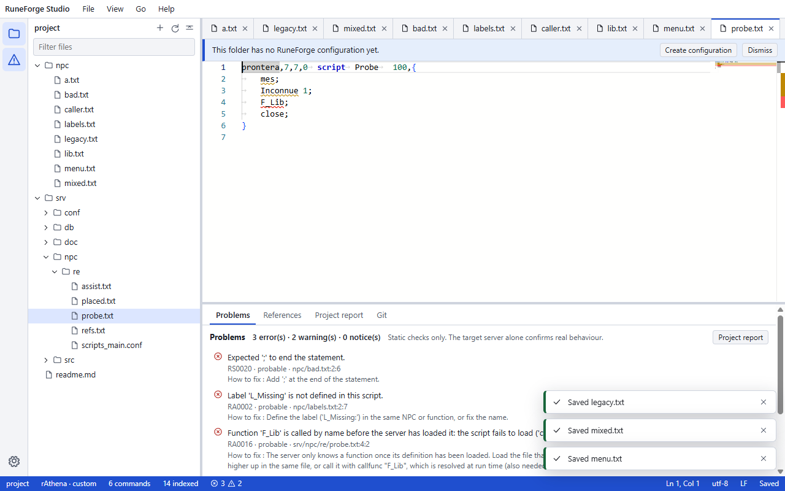

<div align="center">

# RuneForge Studio

**Un IDE de bureau pour écrire et vérifier les scripts de NPC [rAthena](https://github.com/rathena/rathena).**

[](LICENSE)
[](https://github.com/vazan/runeforge-npc-editor/actions/workflows/ci.yml)


[Wiki](https://github.com/vazan/runeforge-npc-editor/wiki) ·
[Premiers pas](https://github.com/vazan/runeforge-npc-editor/wiki/FR-Premiers-Pas) ·
[Journal des modifications](CHANGELOG.md) ·
[English](README.md)



</div>

RuneForge Studio ouvre le dossier de votre serveur rAthena, comprend vos scripts et signale ce que le serveur refuserait — **sans jamais lancer le serveur, et sans toucher à vos fichiers tant que vous n'enregistrez pas.**

> **Pré-version (0.1.0-beta.1).** [À télécharger sur la page des Releases](https://github.com/vazan/runeforge-npc-editor/releases) (un `.exe` Windows et un binaire Linux, sans installateur) ou à construire depuis les sources. Windows 11 est entièrement vérifié ; sous Linux il se construit et passe ses tests, mais la fenêtre a très peu été exercée. rAthena seulement — Hercules n'est pas encore pris en charge. [Ce qui est vérifié et ce qui ne l'est pas →](https://github.com/vazan/runeforge-npc-editor/wiki/FR-Compatibilite-et-Limites)

## Points forts

- **Vos fichiers sont en sécurité.** Rien n'est écrit tant que vous n'enregistrez pas ; encodages, BOM et fins de ligne sont préservés (aller-retour octet pour octet sur 2 303 scripts réels) ; un fichier modifié ailleurs n'est jamais écrasé en silence ; le travail non enregistré survit à un plantage.
- **Il comprend rAthena.** Complétion, survol, aller à la définition, renommage et diagnostics, vérifiés d'après les commandes, objets, monstres, cartes et l'ordre de chargement de *votre* serveur.
- **Des NPC plus vite.** Modèles, assistants, éditeur visuel de dialogues, constructeur en graphe de nœuds et simulateur de dialogues local.
- **Privé par défaut.** Aucune télémétrie ; le réseau n'est utilisé que sur votre demande (mises à jour, IA facultative, aperçu SFTP).

Pour aller plus loin : [diagnostics](https://github.com/vazan/runeforge-npc-editor/wiki/FR-Diagnostics) · [outils NPC](https://github.com/vazan/runeforge-npc-editor/wiki/FR-Outils-NPC) · [Git et déploiement](https://github.com/vazan/runeforge-npc-editor/wiki/FR-Git-et-Deploiement).

## Démarrage rapide

Nécessite Node.js ≥ 22, pnpm 10 et Rust (stable), plus les [outils de la plateforme](docs/DEV_SETUP.md) : outils de build C++ de Visual Studio et WebView2 sous Windows, paquets WebKitGTK 4.1 / GTK 3 / OpenSSL sous Linux.

```bash
git clone https://github.com/vazan/runeforge-npc-editor.git
cd runeforge-npc-editor
pnpm install                                         # pnpm, pas npm
pnpm --filter @runeforge/desktop tauri dev           # le lancer
pnpm --filter @runeforge/desktop tauri build --no-bundle   # ou construire target/release/runeforge-studio
```

Puis **Ouvrir un dossier de projet…** et choisissez votre serveur rAthena (ou son dossier `npc/`). Rien n'est modifié à l'ouverture d'un projet.

## Documentation

- **[Wiki](https://github.com/vazan/runeforge-npc-editor/wiki)** (English et Français) : guide utilisateur, référence des diagnostics, intégration du serveur, architecture, développement.
- **[`docs/`](docs/)** (surtout en français) : le dossier de preuves du projet — [état](docs/STATUS.md), [limites connues](docs/KNOWN_LIMITATIONS.md), [modèle de sécurité](docs/SECURITY.md), [décisions de conception](docs/DECISIONS.md).

## Contribuer

Les contributions sont les bienvenues — surtout les retours issus de vrais serveurs. Lisez [CONTRIBUTING.md](CONTRIBUTING.md) et utilisez les [formulaires de tickets](https://github.com/vazan/runeforge-npc-editor/issues/new/choose) (en français ou en anglais). Une vulnérabilité ? Voir [SECURITY.md](SECURITY.md) ; n'ouvrez pas de ticket public.

## Licence

[GPL-3.0-only](LICENSE). Il intègre des signatures et textes d'aide de commandes dérivés de [rAthena](https://github.com/rathena/rathena) (GPL-3.0) ; aucun code serveur ni base de données rAthena n'est embarqué. Notices tierces : [`docs/THIRD_PARTY_LICENSES.md`](docs/THIRD_PARTY_LICENSES.md). Construit avec [Tauri](https://tauri.app), [React](https://react.dev) et l'[éditeur Monaco](https://github.com/microsoft/monaco-editor).

*RuneForge Studio est un outil non officiel, sans lien avec Gravity. « Ragnarok Online » et « Gravity » sont des marques de leurs titulaires ; « RuneForge Studio » est un nom de travail.*
