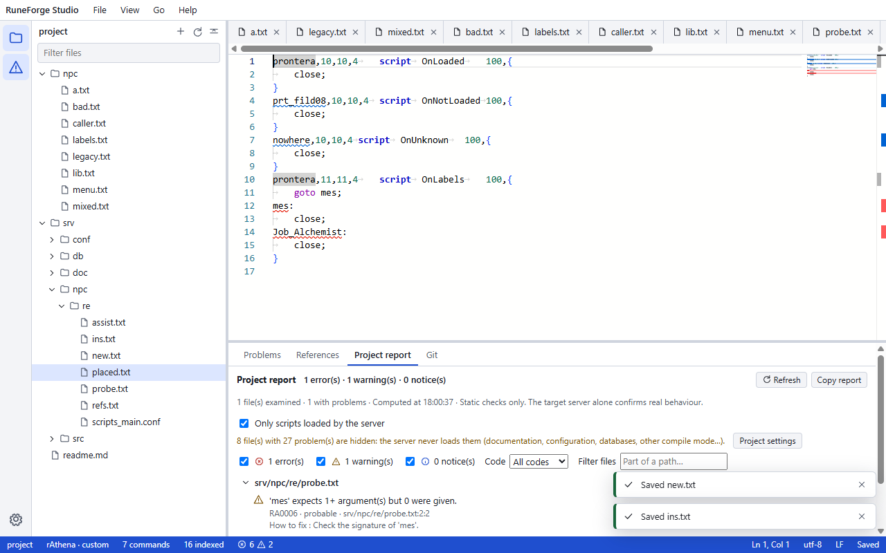
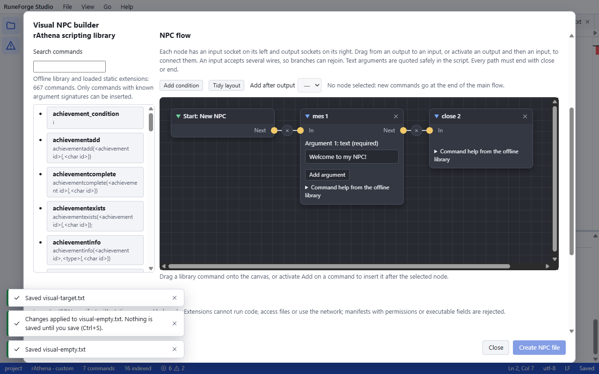
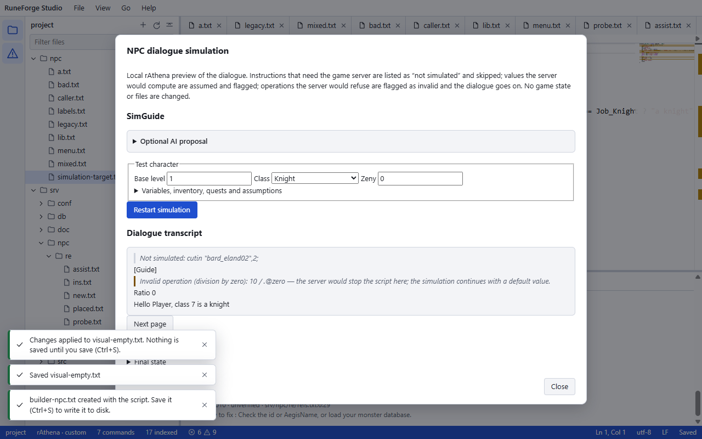
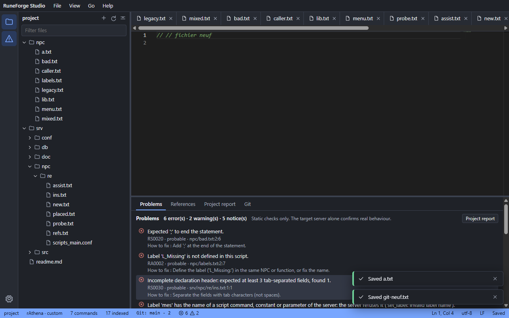

<div align="center">

# RuneForge Studio

**Un IDE de bureau pour écrire et vérifier les scripts de NPC [rAthena](https://github.com/rathena/rathena).**

Il ouvre le dossier de votre serveur, comprend vos scripts et signale ce que le serveur refuserait —<br>sans jamais lancer le serveur, et sans toucher à vos fichiers tant que vous n'enregistrez pas.

[](LICENSE)
[](https://github.com/vazan/runeforge-npc-editor/actions/workflows/ci.yml)


[**Wiki**](https://github.com/vazan/runeforge-npc-editor/wiki) ·
[Premiers pas](https://github.com/vazan/runeforge-npc-editor/wiki/FR-Premiers-Pas) ·
[Journal des modifications](CHANGELOG.md) ·
[Feuille de route](https://github.com/vazan/runeforge-npc-editor/wiki/FR-Feuille-de-route) ·
🇬🇧 [**Read me in English**](README.md)

</div>

<p align="center">
  
</p>

> **Outil non officiel, sans lien avec Gravity.** « Ragnarok Online » et « Gravity » sont des marques de leurs titulaires. *RuneForge Studio* est un nom de travail.

> **Pré-version (version 0.0.0).** Ni installateur ni version publiée pour l'instant — on le construit depuis les sources. **Windows 11** est entièrement vérifié ; sous **Linux**, il se construit et tous les tests passent, mais la fenêtre a très peu été exercée. **Hercules n'est pas encore pris en charge.** Voir [ce qui est vérifié et ce qui ne l'est pas](https://github.com/vazan/runeforge-npc-editor/wiki/FR-Compatibilite-et-Limites).

## Pourquoi RuneForge ?

Les scripts de serveur Ragnarok Online sont du texte brut, souvent dans un encodage hérité, et le serveur en dit peu quand il en ignore un en silence. RuneForge donne aux auteurs de scripts ce qu'un IDE moderne offre aux autres langages — et prend l'intégrité de vos fichiers très au sérieux.

### Vos fichiers sont en sécurité

- Ouvrir puis enregistrer **sans modification n'écrit rien** ; avec modification, seuls les octets modifiés changent. Vérifié par un **aller-retour octet pour octet sur 2 303 scripts réels** (dont 58 en encodage hérité et 4 à fins de ligne mixtes).
- Encodages, BOM et fins de ligne CRLF/LF/mixtes sont préservés. Un caractère que l'encodage ne peut pas contenir **bloque l'enregistrement** au lieu d'être remplacé.
- Un fichier modifié ailleurs n'est **jamais écrasé en silence**. Le travail non enregistré survit à un plantage.
- Aucune télémétrie. Le réseau n'est utilisé que sur votre demande explicite (mises à jour, IA facultative, aperçu SFTP).

### Il comprend les scripts rAthena

- **Analyseur tolérant et sans perte** : diagnostics de syntaxe et sémantiques, aller à la définition, toutes les références, renommage sûr, plan, recherche de symboles dans tout le projet.
- **Complétion, survol et aide de signature** pour les commandes (667 intégrées, hors ligne), labels, fonctions, NPC, variables — et, à partir des fichiers de *votre* serveur, **objets, monstres, cartes et constantes**.
- **Vérifications propres au serveur**, lues à l'exécution dans votre dossier rAthena : commande inconnue, mauvais nombre d'arguments, objet/monstre/carte introuvable, NPC sur une carte que le serveur **ne charge pas** (ignoré sans message), label nommé comme une commande, fonction appelée avant que le serveur l'ait chargée.
- Un **rapport de projet** liste les problèmes de tous les fichiers que le serveur charge réellement.

<table>
  <tr>
    <td width="50%"><br><sub>Rapport de projet : les problèmes de tous les scripts chargés.</sub></td>
    <td width="50%"><br><sub>Constructeur en nœuds : reliez des commandes pour créer un NPC.</sub></td>
  </tr>
  <tr>
    <td width="50%"><br><sub>Simulation de dialogue : jouez un NPC localement.</sub></td>
    <td width="50%"><br><sub>Thème clair, sombre ou système ; interface en anglais ou en français.</sub></td>
  </tr>
</table>

<sub>Les captures proviennent du scénario automatisé de bout en bout, sur un petit projet synthétique (interface en anglais).</sub>

### Des outils pour créer des NPC plus vite

- **Modèles** (`npc-script`, `npc-warp`, `npc-shop`, `npc-healer`) et **assistants** à sortie validée en direct.
- Un **éditeur visuel de dialogues** (blocs) et un **constructeur de NPC en graphe de nœuds**.
- Un **simulateur de dialogues local** qui ne s'arrête jamais sur une erreur : il note ce que le serveur refuserait et continue.
- Une **ébauche par IA** facultative via un point d'accès compatible OpenAI que vous configurez — avec consentement explicite avant chaque envoi, et clés API conservées en mémoire seulement.
- Un **panneau Git** en lecture seule, un **déploiement local** avec sauvegarde et restauration, et une **comparaison SFTP** en lecture seule.
- Des **mises à jour signées** dans l'application depuis les releases GitHub (Windows et Linux) — implémentées, en attente d'une première release signée.

## Premiers pas

**Prérequis :** Node.js ≥ 22, pnpm 10, Rust stable. Sous Windows : Visual Studio Build Tools (C++) et WebView2 (inclus dans Windows 11). Sous Linux : paquets de développement WebKitGTK 4.1, GTK 3 et OpenSSL — voir [`docs/DEV_SETUP.md`](docs/DEV_SETUP.md).

```bash
git clone https://github.com/vazan/runeforge-npc-editor.git
cd runeforge-npc-editor
pnpm install
pnpm --filter @runeforge/desktop tauri dev            # lance en développement
```

Pour construire l'exécutable (aucun installateur n'est produit) :

```bash
pnpm --filter @runeforge/desktop tauri build --no-bundle   # -> target/release/runeforge-studio[.exe]
```

Puis **Ouvrir un dossier de projet…** et choisissez la racine de votre serveur rAthena (ou son dossier `npc/`). Rien n'est modifié à l'ouverture d'un projet. Pas à pas complet : [Premiers pas](https://github.com/vazan/runeforge-npc-editor/wiki/FR-Premiers-Pas).

> ⚠️ Utilisez **pnpm**, jamais `npm install`, dans ce dépôt.

## Plateformes prises en charge

| | État |
|---|---|
| **Windows 11** | Application complète vérifiée, y compris un parcours automatisé de bout en bout sur l'exécutable réel |
| **Linux x86_64** | Se construit ; tous les tests passent sous Ubuntu 26.04 (WSL2) ; fenêtre lancée 20 s seulement. `pnpm build:linux` construit aussi un AppImage |
| **macOS** | Non pris en charge |
| **rAthena** | Renewal vérifié ; logique pre-renewal testée sur des fixtures |
| **Hercules** | Pas encore pris en charge |

## Documentation

| | |
|---|---|
| 📖 **Wiki** (English + Français) | [Accueil](https://github.com/vazan/runeforge-npc-editor/wiki) — guide utilisateur, référence des diagnostics, intégration du serveur, architecture, développement |
| 🧪 **État du projet et preuves** | [`docs/STATUS.md`](docs/STATUS.md) · [`docs/TEST_MATRIX.md`](docs/TEST_MATRIX.md) |
| ⚠️ **Limites connues** | [`docs/KNOWN_LIMITATIONS.md`](docs/KNOWN_LIMITATIONS.md) |
| 🔐 **Modèle de sécurité** | [`docs/SECURITY.md`](docs/SECURITY.md) |
| 🧭 **Décisions de conception** | [`docs/DECISIONS.md`](docs/DECISIONS.md) |
| 📦 **Livraison et mises à jour** | [`docs/RELEASE.md`](docs/RELEASE.md) |
| 📚 **Guides utilisateur** | [Français](docs/GUIDE_UTILISATEUR.md) · [English](docs/USER_GUIDE.md) |

Le dossier `docs/` est la référence détaillée et prouvée (un statut n'est « vérifié » qu'avec une commande exécutée et son résultat). Le wiki en est le résumé lisible.

## Organisation du dépôt

```text
apps/desktop/        Application Tauri 2 + React (src/) et cœur Rust (src-tauri/)
crates/              Rust : filesystem (E/S sûres), git (lecture seule), remote-transport (aperçu SFTP), updater (mises à jour signées)
packages/            Bibliothèques TypeScript : lexer, analyseur, analyse, serveur de langage, adaptateurs d'émulateurs,
                     modèles de NPC, constructeur visuel, simulateur, déploiement, cœur de projet
scripts/             Mesures sur corpus, scénario de bout en bout Windows, outillage de release
docs/                Documents de projet (état, décisions, sécurité, limites…) et captures d'écran
wiki/                Sources du wiki GitHub bilingue
```

Plus de détails dans la page [Architecture](https://github.com/vazan/runeforge-npc-editor/wiki/FR-Architecture).

## Contribuer

Les contributions sont les bienvenues — les rapports de bogues issus de vrais serveurs sont particulièrement précieux.

1. Ouvrez d'abord un ticket pour tout changement important ([modèles](https://github.com/vazan/runeforge-npc-editor/issues/new/choose) : bug report, diagnostic report, feature request ; en français ou en anglais).
2. Lancez `pnpm check:all` (types, lint, tests TypeScript, clippy, tests Rust) avant d'ouvrir une pull request. Sous Windows, `pnpm e2e` pilote l'exécutable réel.
3. Décrivez le *quoi et le pourquoi* et les preuves que vous avez exécutées.

Voir [Développement](https://github.com/vazan/runeforge-npc-editor/wiki/FR-Developpement) pour les conventions. **Ne collez jamais de secret** (clés API, jetons, `*.key`) dans un ticket.

### Sécurité

N'**ouvrez pas de ticket public** pour une vulnérabilité — utilisez le [signalement privé de vulnérabilités](https://github.com/vazan/runeforge-npc-editor/security/advisories/new). Vue d'ensemble : [Confidentialité et sécurité](https://github.com/vazan/runeforge-npc-editor/wiki/FR-Confidentialite-et-Securite). Aucune revue de sécurité externe n'a encore eu lieu.

## Licence

RuneForge Studio est publié sous la **[GNU GPL v3 (GPL-3.0-only)](LICENSE)**. Il intègre des signatures et textes d'aide de commandes dérivés de rAthena (GPL-3.0) ; aucun code serveur ni base de données rAthena n'est embarqué — les fichiers de votre serveur sont lus à l'exécution. Licences tierces : [`docs/THIRD_PARTY_LICENSES.md`](docs/THIRD_PARTY_LICENSES.md). C'est un inventaire, pas un avis juridique ; voir [Licence](https://github.com/vazan/runeforge-npc-editor/wiki/FR-Licence).

## Remerciements

Construit sur [Tauri](https://tauri.app), [React](https://react.dev), l'[éditeur Monaco](https://github.com/microsoft/monaco-editor) et [Vite](https://vite.dev). La sémantique des scripts et la documentation des commandes viennent du projet [rAthena](https://github.com/rathena/rathena) et de son équipe.
