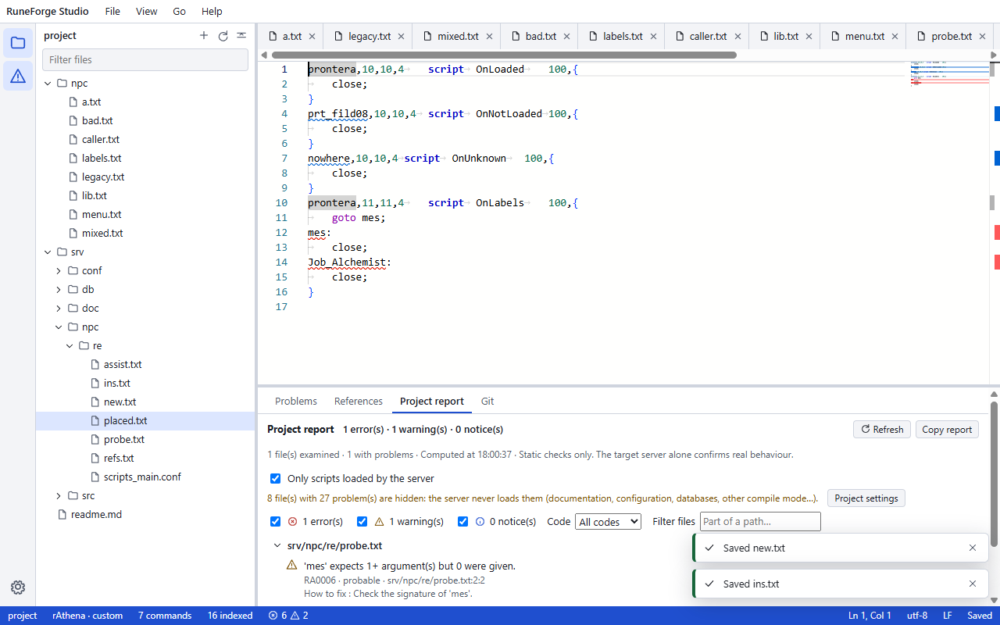
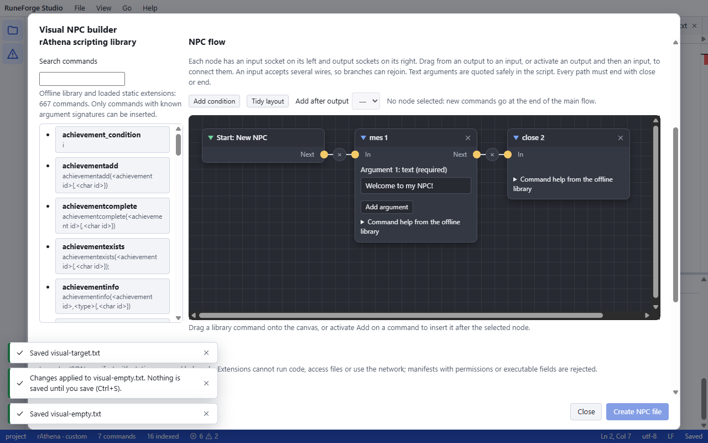
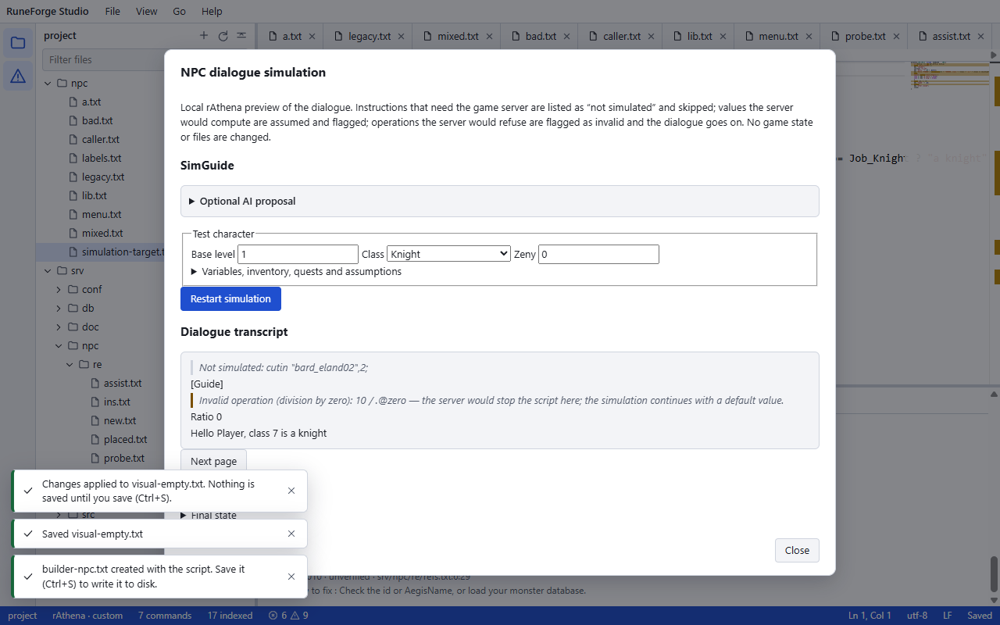
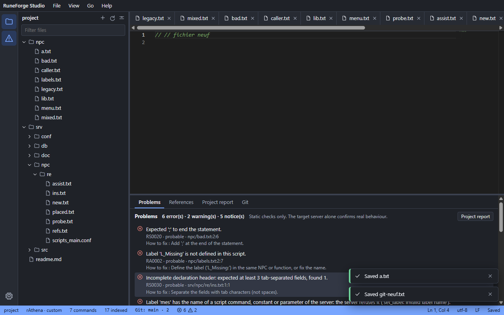

<div align="center">

# RuneForge Studio

**A desktop IDE for writing and checking [rAthena](https://github.com/rathena/rathena) NPC scripts.**

It opens your server folder, understands your scripts, and tells you what the server would complain about —<br>without ever running the server, and without touching your files unless you save.

[](LICENSE)
[](https://github.com/vazan/runeforge-npc-editor/actions/workflows/ci.yml)


[**Wiki**](https://github.com/vazan/runeforge-npc-editor/wiki) ·
[Getting started](https://github.com/vazan/runeforge-npc-editor/wiki/EN-Getting-Started) ·
[Changelog](CHANGELOG.md) ·
[Roadmap](https://github.com/vazan/runeforge-npc-editor/wiki/EN-Roadmap) ·
🇫🇷 [**Lisez-moi en français**](README.fr.md)

</div>

<p align="center">
  
</p>

> **Unofficial tool, not affiliated with Gravity.** "Ragnarok Online" and "Gravity" are trademarks of their owners. *RuneForge Studio* is a working name.

> **Pre-release (version 0.0.0).** No installer and no published build yet — you build it from source. **Windows 11** is fully verified; on **Linux** it builds and all tests pass, but the window has barely been exercised. **Hercules is not supported yet.** See [what is and isn't verified](https://github.com/vazan/runeforge-npc-editor/wiki/EN-Compatibility-and-Limitations).

## Why RuneForge?

Ragnarok Online server scripts are plain text, often legacy-encoded, and the server tells you little when it silently ignores one. RuneForge gives script authors what a modern IDE gives other languages — and takes your files' integrity seriously.

### Your files are safe

- Opening then saving **without changes writes nothing**; with changes, only the changed bytes differ. Verified by a **byte-for-byte round trip over 2,303 real scripts** (58 in legacy encodings, 4 with mixed line endings).
- Encodings, BOMs and CRLF/LF/mixed line endings are preserved. A character the encoding cannot hold **blocks the save** instead of being replaced.
- A file changed elsewhere is **never overwritten silently**. Unsaved work survives a crash.
- No telemetry. The network is used only when you explicitly ask (updates, optional AI, SFTP preview).

### It understands rAthena scripts

- **Tolerant, lossless parser**: syntax and semantic diagnostics, go to definition, find references, safe rename, outline, project-wide symbol search.
- **Completion, hover and signature help** for commands (667 bundled offline), labels, functions, NPCs, variables — and, from *your* server's files, **items, monsters, maps and constants**.
- **Server-aware checks** read at runtime from your rAthena folder: unknown command, wrong argument count, unknown item/monster/map, an NPC on a map the server **doesn't load** (ignored with no message), a label named like a command, a function called before the server has loaded it.
- A **project report** lists problems across every file the server really loads.

<table>
  <tr>
    <td width="50%"><br><sub>Project report: problems across all loaded scripts.</sub></td>
    <td width="50%"><br><sub>Node builder: wire commands into a new NPC.</sub></td>
  </tr>
  <tr>
    <td width="50%"><br><sub>Dialogue simulation: play an NPC locally.</sub></td>
    <td width="50%"><br><sub>Light, dark or system theme; English or French UI.</sub></td>
  </tr>
</table>

<sub>Screenshots come from the automated end-to-end scenario on a small synthetic project.</sub>

### Tools to build NPCs faster

- **Templates** (`npc-script`, `npc-warp`, `npc-shop`, `npc-healer`) and **wizards** with live, validated output.
- A **visual dialogue editor** (blocks) and a **node-graph NPC builder**.
- A **local dialogue simulator** that never stops on an error: it notes what the server would refuse and keeps going.
- Optional **AI drafting** through an OpenAI-compatible endpoint you configure — with explicit consent before every send, and API keys kept in memory only.
- A read-only **Git panel**, **local deployment** with backup and restore, and a read-only **SFTP comparison**.
- **Signed in-app updates** from GitHub releases (Windows and Linux) — implemented, awaiting a first signed release.

## Getting started

**Requirements:** Node.js ≥ 22, pnpm 10, Rust stable. On Windows: Visual Studio Build Tools (C++) and WebView2 (included in Windows 11). On Linux: WebKitGTK 4.1, GTK 3 and OpenSSL development packages — see [`docs/DEV_SETUP.md`](docs/DEV_SETUP.md).

```bash
git clone https://github.com/vazan/runeforge-npc-editor.git
cd runeforge-npc-editor
pnpm install
pnpm --filter @runeforge/desktop tauri dev            # run in development
```

To build the executable (no installer is produced):

```bash
pnpm --filter @runeforge/desktop tauri build --no-bundle   # -> target/release/runeforge-studio[.exe]
```

Then **Open project folder…** and pick the root of your rAthena server (or its `npc/` folder). Nothing is modified when a project opens. Full walkthrough: [Getting started](https://github.com/vazan/runeforge-npc-editor/wiki/EN-Getting-Started).

> ⚠️ Use **pnpm**, never `npm install`, in this repository.

## Platform support

| | State |
|---|---|
| **Windows 11** | Full application verified, including an automated end-to-end run on the real executable |
| **Linux x86_64** | Builds; all tests pass on Ubuntu 26.04 (WSL2); window launched for 20 s only. `pnpm build:linux` also builds an AppImage |
| **macOS** | Not supported |
| **rAthena** | Renewal verified; pre-renewal logic tested on fixtures |
| **Hercules** | Not supported yet |

## Documentation

| | |
|---|---|
| 📖 **Wiki** (English + Français) | [Home](https://github.com/vazan/runeforge-npc-editor/wiki) — user guide, diagnostics reference, server integration, architecture, development |
| 🧪 **Project status and evidence** | [`docs/STATUS.md`](docs/STATUS.md) · [`docs/TEST_MATRIX.md`](docs/TEST_MATRIX.md) *(French)* |
| ⚠️ **Known limitations** | [`docs/KNOWN_LIMITATIONS.md`](docs/KNOWN_LIMITATIONS.md) *(French)* |
| 🔐 **Security model** | [`docs/SECURITY.md`](docs/SECURITY.md) *(French)* |
| 🧭 **Design decisions** | [`docs/DECISIONS.md`](docs/DECISIONS.md) *(French)* |
| 📦 **Releasing and updates** | [`docs/RELEASE.md`](docs/RELEASE.md) *(French)* |
| 📚 **User guides** | [English](docs/USER_GUIDE.md) · [Français](docs/GUIDE_UTILISATEUR.md) |

The `docs/` folder is the detailed, evidence-backed source of truth (a status is "verified" only with an executed command and its result). The wiki is the readable summary.

## Project layout

```text
apps/desktop/        Tauri 2 + React application (src/) and Rust core (src-tauri/)
crates/              Rust: filesystem (safe I/O), git (read-only), remote-transport (SFTP preview), updater (signed updates)
packages/            TypeScript libraries: lexer, parser, analysis, language server, emulator adapters,
                     NPC templates, visual builder, simulator, deployment, project core
scripts/             Corpus measurements, Windows end-to-end scenario, release tooling
docs/                Project documents (status, decisions, security, limits…) and screenshots
wiki/                Sources of the bilingual GitHub wiki
```

More in the [Architecture](https://github.com/vazan/runeforge-npc-editor/wiki/EN-Architecture) page.

## Contributing

Contributions are welcome — bug reports from real servers are especially valuable.

1. Open an issue first for anything sizeable ([templates](https://github.com/vazan/runeforge-npc-editor/issues/new/choose): bug report, diagnostic report, feature request; English or French).
2. Run `pnpm check:all` (type-check, lint, TypeScript tests, clippy, Rust tests) before opening a pull request. On Windows, `pnpm e2e` drives the real executable.
3. Describe the *what and why* and the evidence you ran.

See [Development](https://github.com/vazan/runeforge-npc-editor/wiki/EN-Development) for conventions. **Never paste secrets** (API keys, tokens, `*.key`) in an issue.

### Security

Please **do not open a public issue** for a vulnerability — use [private vulnerability reporting](https://github.com/vazan/runeforge-npc-editor/security/advisories/new). Overview: [Privacy and security](https://github.com/vazan/runeforge-npc-editor/wiki/EN-Privacy-and-Security). No external security review has been done yet.

## License

RuneForge Studio is released under the **[GNU GPL v3 (GPL-3.0-only)](LICENSE)**. It bundles command signatures and help text derived from rAthena (GPL-3.0); no rAthena server code or database is embedded — your server's files are read at runtime. Third-party licenses: [`docs/THIRD_PARTY_LICENSES.md`](docs/THIRD_PARTY_LICENSES.md). This is an inventory, not legal advice; see [License](https://github.com/vazan/runeforge-npc-editor/wiki/EN-License).

## Acknowledgements

Built on [Tauri](https://tauri.app), [React](https://react.dev), the [Monaco editor](https://github.com/microsoft/monaco-editor) and [Vite](https://vite.dev). Script semantics and command documentation come from the [rAthena](https://github.com/rathena/rathena) project and its Dev Team.
