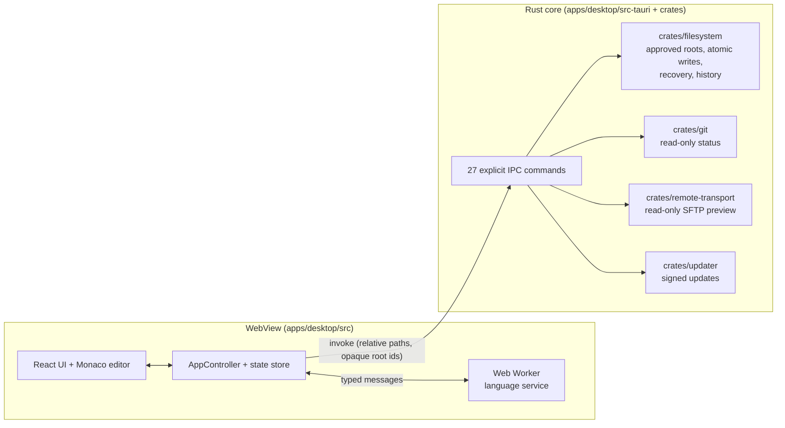
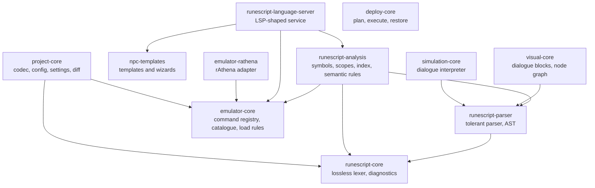

# Architecture

*🇫🇷 [Version française](FR-Architecture)*

A map of how RuneForge Studio is built, for contributors. The authoritative record of *why* is [`docs/DECISIONS.md`](https://github.com/vazan/runeforge-npc-editor/blob/HEAD/docs/DECISIONS.md) (48 numbered decisions, in French); this page cites them as `DEC-nnn`.

## Big picture

RuneForge is a **Tauri 2** desktop application: a React + TypeScript interface in a system WebView (WebView2 on Windows, WebKitGTK on Linux) talking to a small **Rust** core. The heavy language work runs in a **Web Worker**, off the UI thread.

- The **web page never sees an absolute path** and has no generic file or shell permission (DEC-014). It names *approved roots* by opaque id and sends *relative paths*; Rust validates, canonicalises and checks containment.
- The **language service** (parse, analyse, index, answer completion/hover/diagnostics) lives in pure TypeScript packages, driven through a typed, LSP-shaped message protocol with anti-staleness by document version (DEC-023).
- **Emulator knowledge** (command tables, load order, databases) is read **at runtime from the user's server files** through an adapter, never embedded (DEC-012), apart from the bundled offline command library (DEC-041).

## Repository layout

| Path | Role |
|---|---|
| `apps/desktop/src` | React UI (`features/`), `AppController` (`app/`), document and store state (`state/`), Monaco setup, Web Worker (`workers/`), backend service (`services/`), FR/EN messages (`i18n/`) |
| `apps/desktop/src-tauri` | Tauri application: command handlers, capabilities (permissions), CSP in `tauri.conf.json`, the updater public key |
| `crates/filesystem` | Safe file services: approved roots, path guard, atomic write with precondition, recovery snapshots, local history, config, diagnostic log |
| `crates/git` | Read-only Git (`status`, `cat-file`) with a cleared environment, timeouts and output limits |
| `crates/remote-transport` | Read-only SFTP v3 client driven through the system OpenSSH client |
| `crates/updater` | Signed-manifest update client: minisign verification, GitHub release reading, verified download, executable replacement |
| `packages/*` | Pure TypeScript libraries (below) |
| `scripts/` | Corpus measurements, end-to-end scenarios (Windows), release tooling |
| `docs/` | Evidence-backed project documents (French) |
| `wiki/` | The sources of this wiki |

## TypeScript packages

| Package | Responsibility |
|---|---|
| `runescript-core` | **Lossless** lexer (tokens concatenate back to the exact source), diagnostic catalogue in FR/EN. No UI or OS dependency |
| `runescript-parser` | **Tolerant** parser: any text yields an AST with exact source ranges; unreadable fragments become raw nodes, never dropped |
| `runescript-analysis` | Symbols, label scopes, references, the incremental workspace index and the `RA…` semantic diagnostics |
| `runescript-language-server` | Definition, references, outline, symbol search, completion, hover, signature help, safe rename, project report |
| `emulator-core` | Emulator-neutral registry of sourced commands, reference catalogue (items, monsters, maps, constants), argument-notation parser, `scripts_*.conf` load rules |
| `emulator-rathena` | Reads rAthena's command table, manual, mode, loaded scripts and `db/*.yml` from the user's files |
| `npc-templates` | Statically validated templates and wizard definitions |
| `visual-core` | Block import and targeted edits of NPC dialogues; node-graph builder (the graph edits, `buildVisualNpc` writes) |
| `simulation-core` | A bounded interpreter that plays an NPC dialogue and *notes* what it cannot compute |
| `deploy-core` | Plan, execute and restore deployments |
| `project-core` | Lossless encoding/BOM/EOL codec, project configuration, settings, session, diff, file tree |

Internal packages are consumed **as TypeScript source**, with no build step (DEC-003).

## Two flows worth knowing

**Opening a project.** Native folder dialog → approved root → `scan_project` → files read in batches → the worker parses and indexes them → the server profile is detected → the rAthena adapter reads the command table, load order, maps and databases through the same file service → the registry and catalogue are handed to the language service, which re-analyses open documents. Nothing is written.

**Saving.** On open, the encoding is detected (BOM → strict UTF-8 → legacy encoding, `windows-1252` by default) and the bytes must round-trip exactly (DEC-015). The editor works on LF text; on save the original line endings are re-applied (line-diff for mixed files) and `write_file` is called with the **SHA-256 of the file as last read** (DEC-014). Rust refuses if the file changed meanwhile; otherwise it writes a neighbouring temporary file, syncs it and renames it over the original, after copying the previous version into the local history. A character the encoding cannot represent blocks the save. Opening and saving without edits writes nothing.

## Design principles (recurring in `DECISIONS.md`)

1. **Source text is sacred** — lossless lexing, byte-preserving save.
2. **Evidence before claims** — a status is `VERIFIED` only with an executed command and result; rules are proven in the server's code, then compared with independent oracles and deliberate mutations.
3. **Silence over invention** — without proof (no registry, Hercules), the application says nothing rather than guessing.
4. **Least privilege** — explicit IPC commands, no plugin permissions given to the page.
5. **Nothing without consent** — network, Git and SFTP only on explicit action.

## Quality gates

`pnpm check:all` runs type-checking (strict TypeScript, `noUncheckedIndexedAccess`), ESLint, the Vitest suite, `cargo clippy -D warnings` and the Rust tests. An end-to-end scenario drives the **real Windows executable** through WebView2's debugging protocol; a separate script audits accessibility; measurement scripts under `scripts/` run the parser and analyses over real server corpora. See [Development](EN-Development).
