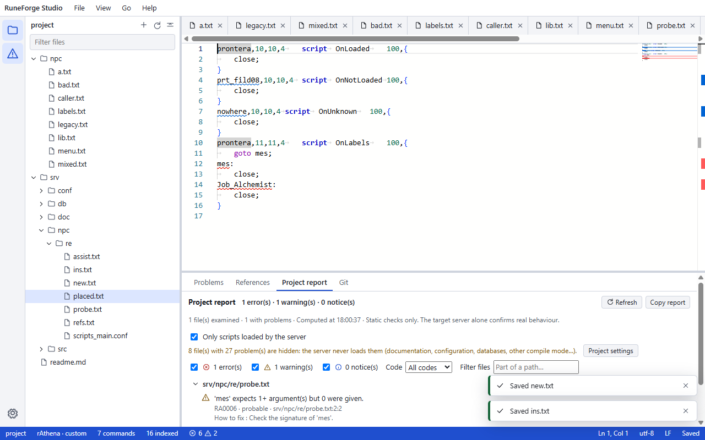

# Diagnostics

*🇫🇷 [Version française](FR-Diagnostics)*

RuneForge checks your scripts as you type and across the whole project. **A local analysis is not a run of the server**: only your server confirms real behaviour. That is why each message carries a **confidence level**.

## Reading a message

Every problem says **what**, **where**, **why** and **how to fix**, for example:

> **Label 'L_Missing' is not defined in this script.**
> `RA0002 · probable · npc/labels.txt:2:7`
> *How to fix: define the label (`L_Missing:`) in the same NPC or function, or fix the name.*

| Confidence | Meaning |
|---|---|
| **certain** | The server's code leaves no doubt (for example a label defined twice in one script) |
| **probable** | Derived from reading the server's code; the server itself was never run to confirm it |
| **unverified** | The server may know more than the files RuneForge could read (for example an item that exists only in a database RuneForge did not see) |

## Where problems appear

- **In the editor**: underlines and markers.
- **Problems panel** (`Ctrl+J`): the current file.
- **Project report** (`Ctrl+Shift+M`): every indexed file, most serious first, click to open at the exact position, **copy as text** for a bug report (it never contains the content of your scripts).

For a recognised server, the report is **restricted by default to the scripts the server actually loads**; documentation, databases and the other compile mode are hidden (their count is shown, and a checkbox reveals them).

## Code reference

| Code | Means | Needs a server? |
|---|---|---|
| `RS…` | **Syntax**: unterminated string or block comment, `;` expected, incomplete declaration header, unknown declaration type, nesting too deep… | No |
| `RA0001` | Command unknown to the server (or a function no file defines) | Yes |
| `RA0006` | Wrong **number of arguments** for a command (from the server's command table) | Yes |
| `RA0002` | `goto`, `callsub`, `menu` or `jump_zero` to a label that does not exist | No |
| `RA0003` | Label or local function defined twice | No |
| `RA0012` | `function X;` declared but never defined | No |
| `RA0004` | `callfunc "X"` with no definition of `X` (complete index only) | No |
| `RA0013` | `duplicate(X)` whose source NPC is missing (complete index only) | No |
| `RA0005` | Duplicate NPC unique name | No |
| `RA0011` | Global function defined several times | No |
| `RA0008` | **Map** not found in the server's map index (also checks NPC declarations and warp destinations) | Yes |
| `RA0009` | **Item** not found in the server's item database | Yes |
| `RA0010` | **Monster** not found in the server's monster database | Yes |
| `RA0015` | NPC declared on a map the server **does not load** — the server ignores it **without any message** | Yes |
| `RA0014` | Label named like a command, a constant or a parameter — the server refuses it (`set_label: invalid label name`) | Yes |
| `RA0016` | Function called **by name** before the server has loaded it — the script fails to load (`callfunc "Name"` is not concerned) | Yes |
| `RA0007` | Label never referenced (off by default) | No |

The full catalogue with severity, confidence and the server-source evidence for each rule is in [`docs/LANGUAGE_SPEC.md`](https://github.com/vazan/runeforge-npc-editor/blob/HEAD/docs/LANGUAGE_SPEC.md).

## Tuning the checks

In **Settings › Project** you can:

- lower or turn off alerts about **unknown commands** and **unresolved references** (items, monsters, maps);
- enable **cross-file checks** (`validation.crossFile`, off by default) for unresolved functions and duplicate NPC names — reliable only with the "scripts loaded by the server" index scope;
- choose the **index scope**: `sources` (everything your patterns match) or `loaded` (only scripts the server loads). Indexing a whole `npc/` folder mixes mutually exclusive variants (`re/` and `pre-re/`) and creates false duplicates; `loaded` avoids that.

## Why a rule may stay silent

RuneForge never invents information. Without a recognised rAthena server — a standalone script folder, a Hercules project, or a precompiled server without `src/` — the server-specific rules (`RA0001`, `RA0006`, `RA0008`–`RA0010`, `RA0014`–`RA0016`) are not emitted, and the status bar says so.

## How trustworthy are these rules?

They were derived from reading the server's code, then compared with **independent oracles** and **deliberate mutations** on a real server (841 loaded scripts, 9,000+ NPCs): for example 0 false alarms on 557,894 real command calls, and every one of 4,200 mutated calls flagged in the right place. The evidence trail is in [`docs/STATUS.md`](https://github.com/vazan/runeforge-npc-editor/blob/HEAD/docs/STATUS.md) and [`docs/TEST_MATRIX.md`](https://github.com/vazan/runeforge-npc-editor/blob/HEAD/docs/TEST_MATRIX.md). It was measured on one rAthena fork in Renewal mode; see [Compatibility and limitations](EN-Compatibility-and-Limitations).
