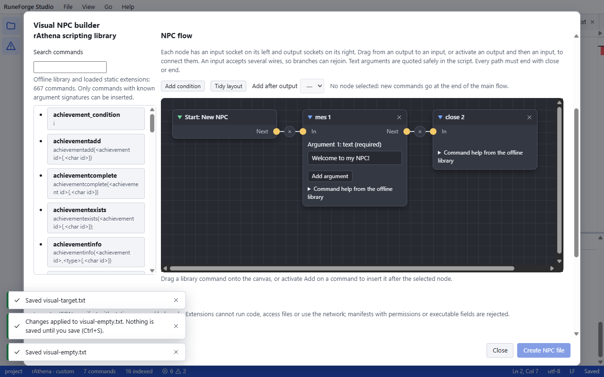
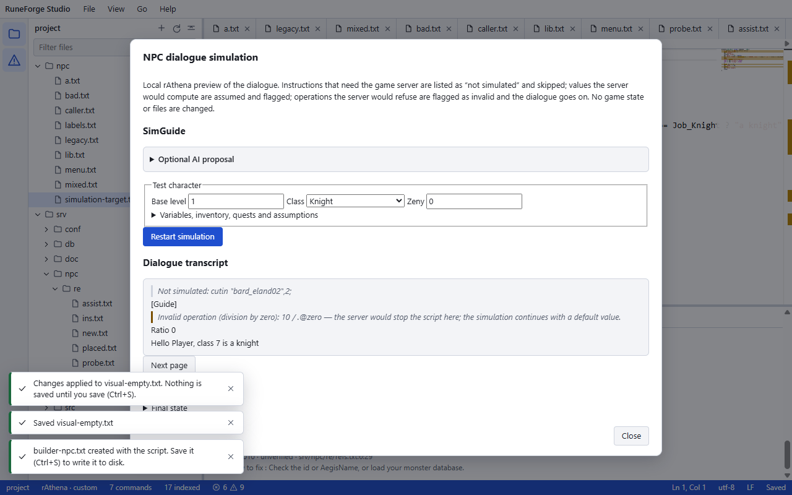

# NPC tools

*🇫🇷 [Version française](FR-Outils-NPC)*

Besides the editor, RuneForge ships five ways to create or inspect an NPC without hand-typing everything. They are all in the **File** menu and the command palette. **None of them runs your game server**, and none writes a file until you press `Ctrl+S`.

| Tool | Menu entry | Good for |
|---|---|---|
| [Templates](EN-Language-Features#npc-templates) | type `npc-` in the editor | Fast skeletons |
| [NPC wizards](#npc-wizards) | File › NPC wizard… | Warp, warper, shop, healer from a validated form |
| [Visual dialogue editor](#visual-dialogue-editor) | File › Visual dialogue editor… | Editing the dialogue of an existing NPC as blocks |
| [Visual NPC builder](#visual-npc-builder-node-graph) | File › Create NPC with visual builder… | Creating a new NPC by wiring nodes |
| [Dialogue simulation](#dialogue-simulation) | File › Simulate NPC dialogue… | Playing an NPC locally to see its dialogue |
| [AI generation](#optional-ai-assistance) | File › Generate NPC from prompt… | Drafting a script from a prompt (optional) |

## NPC wizards

Four rAthena forms: **warp portal**, **warper NPC**, **shop**, **healer**.

- Fill in the fields; the **script is generated live** on the right.
- Each field says what is wrong (number, map name, sprite, item list…). **No script is produced while an error remains.** A warning (price of 0, absurd price, duplicate item) blocks nothing.
- A **local check** — the same analysis as the editor — then reports problems in the generated script.
- Three explicit outputs:
  - **Copy** to the clipboard;
  - **Add to the open file** — appended **at the end** of the displayed file, undoable with `Ctrl+Z`; written to disk only when you save;
  - **Create the file** — makes a new file (name editable; an existing file is never overwritten) containing the script, to save with `Ctrl+S`.

A server only loads a script file that one of your `scripts_*.conf` lists — RuneForge never edits those files. Proposed texts are in plain English (ASCII), because in-game text encoding depends on your server and client. Quality check: 1,600 randomly generated scripts against a real server's data produced no diagnostic, and 980/980 invalid inputs were refused on the right field. No generated script has been loaded by a running server.

## Visual dialogue editor

Opens the NPC under the cursor and shows its dialogue as **blocks** (`mes`, `next`, `close`, `if` branches). Instructions it does not understand stay **locked** and are preserved untouched. You review a diff, apply the changes to the document, then save. It works on one NPC with a closed body in the current file; loops, `select` and `goto` flows are not editable as blocks yet.

## Visual NPC builder (node graph)

A node editor that **creates** a new NPC:

1. **Drag** a command from the offline rAthena library onto the canvas (or activate it to insert it after the selected node).
2. **Wire** nodes: drag from a node's **output socket** (right edge) to another node's **input socket** (left edge). The script follows the wires, not the node positions.
3. A **condition** node has **Then** and **Otherwise** outputs; several wires can enter one input so branches can rejoin.
4. Every path must end with `close` or `end`. Unwired nodes or outputs block creation with an explanation; a wire that would loop the flow is refused.
5. The generated script is checked locally before a new **unsaved** project file is created.

Keyboard only: activate an output socket, then an input socket; `Delete` on an output disconnects it; `Escape` cancels a connection in progress.

Only commands with a known argument signature are enabled. The builder can also load a **temporary JSON extension manifest** of static command names, signatures and help — it accepts **no code and no permissions**, and nothing is persisted. Not supported yet: re-reading an *existing* script as a graph, `select`/`menu` with several outputs, `goto`, loops, undo/redo.

## Dialogue simulation

Plays the NPC under the cursor in a local preview — no server, no file or game state touched.

- Runs variables of every scope (an unset variable is 0, like on the server), constants, arrays, `switch`, loops, `callsub`, `callfunc` (including functions from other project files the index knows), quest and inventory commands, `input` and `close2`.
- Pick the **test character** by **class name** (the names the server gives, such as *Knight*, *High Priest*, *Rune Knight* — in English in both UI languages), plus level and Zeny. Under *Variables, inventory, quests and assumptions* set the character's state; the random seed makes a run repeatable.
- **It never stops on an error.** Anything the server would refuse (division by zero, a missing argument, an unknown label…) shows as an *Invalid operation* line with the reason, and the dialogue continues with a default value. Instructions that need the game server (`warp`, `cutin`, `specialeffect`…) are listed as *Not simulated* and skipped; values the server would compute are *assumed* and flagged.
- Only resource limits (an endless loop, too much text) interrupt a run.

> **A run that reaches its end does not prove the NPC works on the server.** The "Not simulated" and "Assumed result" lines are the list of what was *not* computed. After an invalid operation the real server would have stopped the script.

Measured on a reference server: all 9,211 NPCs, 73,688 plays, 0 internal failures; 196,648 further plays on randomly corrupted scripts raised no exception. Events (`OnTimer`, `OnTouch`, `donpcevent`) are not triggered — only a click on the NPC is played.

## Optional AI assistance

Two optional features use an **OpenAI-compatible** endpoint you configure in **Settings › AI model** (base URL, for example `http://127.0.0.1:8000/v1`, and model name):

- **AI proposal** (inside the simulation dialog): suggests a revision of the displayed NPC.
- **Generate NPC from prompt…**: drafts a new NPC from a prompt alone.

Safeguards:

- Nothing is sent without **explicit consent**; the exact NPC source (proposal mode only), prompt, endpoint and model are shown first.
- An endpoint outside the loopback address needs a **separate confirmation**. Plain `http` is accepted only for loopback or private IPv4 addresses and is **not encrypted** — use it only on a trusted network.
- The API key is held **in memory only**, never saved, and sent as a Bearer token.
- Suggestions are validated locally and shown **beside the original**. Approving one **creates a separate unsaved file**; it never replaces your document.

No real AI provider has been verified yet; the tests use a simulated transport.
