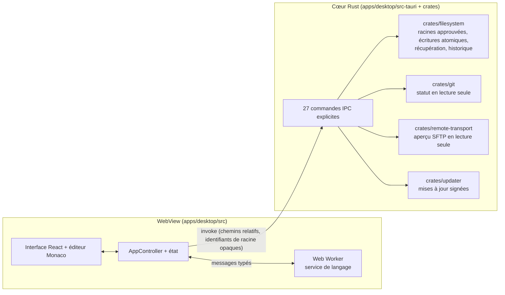
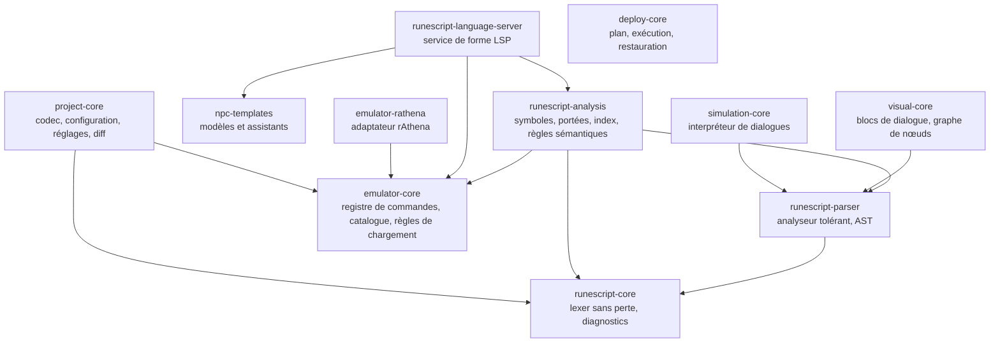

# Architecture

*🇬🇧 [English version](EN-Architecture)*

Une carte de la construction de RuneForge Studio, pour les contributeurs. Le registre de référence du *pourquoi* est [`docs/DECISIONS.md`](https://github.com/vazan/runeforge-npc-editor/blob/HEAD/docs/DECISIONS.md) (48 décisions numérotées) ; cette page les cite sous la forme `DEC-nnn`.

## Vue d'ensemble

RuneForge est une application de bureau **Tauri 2** : une interface React + TypeScript dans une WebView du système (WebView2 sous Windows, WebKitGTK sous Linux) qui dialogue avec un petit cœur **Rust**. Le gros du travail de langage s'exécute dans un **Web Worker**, hors du fil de l'interface.

- **La page web ne voit jamais de chemin absolu** et n'a aucune permission générique de fichiers ou d'interpréteur (DEC-014). Elle désigne des *racines approuvées* par un identifiant opaque et envoie des *chemins relatifs* ; Rust valide, canonicalise et vérifie l'appartenance à la racine.
- **Le service de langage** (analyser, indexer, répondre à la complétion, au survol et aux diagnostics) vit dans des paquets TypeScript purs, pilotés par un protocole de messages typé, calqué sur LSP, avec une protection contre la péremption par version de document (DEC-023).
- **La connaissance des émulateurs** (tables de commandes, ordre de chargement, bases) est lue **à l'exécution dans les fichiers du serveur de l'utilisateur** par un adaptateur, jamais embarquée (DEC-012), hormis la bibliothèque de commandes hors ligne intégrée (DEC-041).

## Organisation du dépôt

| Chemin | Rôle |
|---|---|
| `apps/desktop/src` | Interface React (`features/`), `AppController` (`app/`), état des documents et du magasin (`state/`), configuration de Monaco, Web Worker (`workers/`), service d'accès au cœur (`services/`), messages FR/EN (`i18n/`) |
| `apps/desktop/src-tauri` | Application Tauri : gestionnaires de commandes, capacités (permissions), CSP dans `tauri.conf.json`, clé publique des mises à jour |
| `crates/filesystem` | Services de fichiers sûrs : racines approuvées, garde des chemins, écriture atomique avec précondition, instantanés de récupération, historique local, configuration, journal de diagnostic |
| `crates/git` | Git en lecture seule (`status`, `cat-file`) avec environnement vidé, délais et limites de sortie |
| `crates/remote-transport` | Client SFTP v3 en lecture seule, piloté par le client OpenSSH du système |
| `crates/updater` | Client de mises à jour à manifeste signé : vérification minisign, lecture des releases GitHub, téléchargement vérifié, remplacement de l'exécutable |
| `packages/*` | Bibliothèques TypeScript pures (ci-dessous) |
| `scripts/` | Mesures sur corpus, scénarios de bout en bout (Windows), outillage de release |
| `docs/` | Documents de projet prouvés (en français) |
| `wiki/` | Les sources de ce wiki |

## Paquets TypeScript

| Paquet | Responsabilité |
|---|---|
| `runescript-core` | Lexer **sans perte** (les jetons se recollent en exactement le source), catalogue de diagnostics FR/EN. Aucune dépendance à l'interface ni au système |
| `runescript-parser` | Analyseur **tolérant** : tout texte produit un AST avec des plages de source exactes ; les fragments illisibles deviennent des nœuds bruts, jamais supprimés |
| `runescript-analysis` | Symboles, portées de labels, références, index de projet incrémental et diagnostics sémantiques `RA…` |
| `runescript-language-server` | Définition, références, plan, recherche de symboles, complétion, survol, aide de signature, renommage sûr, rapport de projet |
| `emulator-core` | Registre de commandes sourcées neutre vis-à-vis de l'émulateur, catalogue de références (objets, monstres, cartes, constantes), lecteur de notation des arguments, règles de chargement `scripts_*.conf` |
| `emulator-rathena` | Lit la table des commandes, le manuel, le mode, les scripts chargés et les `db/*.yml` de rAthena dans les fichiers de l'utilisateur |
| `npc-templates` | Modèles validés statiquement et définitions des assistants |
| `visual-core` | Import en blocs et modifications ciblées des dialogues de NPC ; constructeur en graphe de nœuds (le graphe édite, `buildVisualNpc` écrit) |
| `simulation-core` | Un interpréteur borné qui joue un dialogue de NPC et *note* ce qu'il ne sait pas calculer |
| `deploy-core` | Planifier, exécuter et restaurer les déploiements |
| `project-core` | Codec sans perte d'encodage/BOM/fins de ligne, configuration du projet, réglages, session, diff, arbre de fichiers |

Les paquets internes sont consommés **en TypeScript source**, sans étape de construction (DEC-003).

## Deux parcours à connaître

**Ouvrir un projet.** Dialogue natif de choix de dossier → racine approuvée → `scan_project` → fichiers lus par lots → le worker les analyse et les indexe → le profil du serveur est détecté → l'adaptateur rAthena lit la table des commandes, l'ordre de chargement, les cartes et les bases par le même service de fichiers → le registre et le catalogue sont remis au service de langage, qui réanalyse les documents ouverts. Rien n'est écrit.

**Enregistrer.** À l'ouverture, l'encodage est détecté (BOM → UTF-8 strict → encodage hérité, `windows-1252` par défaut) et les octets doivent se restituer à l'identique (DEC-015). L'éditeur manipule un texte en LF ; à l'enregistrement, les fins de ligne d'origine sont réappliquées (diff de lignes pour les fichiers mixtes) et `write_file` est appelé avec le **SHA-256 du fichier tel que lu en dernier** (DEC-014). Rust refuse si le fichier a changé entre-temps ; sinon il écrit un fichier temporaire voisin, le synchronise et le renomme par-dessus l'original, après avoir copié la version précédente dans l'historique local. Un caractère que l'encodage ne peut pas représenter bloque l'enregistrement. Ouvrir puis enregistrer sans modification n'écrit rien.

## Principes de conception (récurrents dans `DECISIONS.md`)

1. **Le texte source est sacré** — lexer sans perte, enregistrement qui préserve les octets.
2. **Des preuves avant les affirmations** — un statut n'est `VERIFIED` qu'avec une commande exécutée et son résultat ; les règles sont prouvées dans le code du serveur, puis confrontées à des oracles indépendants et à des mutations volontaires.
3. **Le silence plutôt que l'invention** — sans preuve (pas de registre, Hercules), l'application ne dit rien plutôt que de deviner.
4. **Privilèges minimaux** — commandes IPC explicites, aucune permission de plugin donnée à la page.
5. **Rien sans consentement** — réseau, Git et SFTP seulement sur action explicite.

## Garde-fous de qualité

`pnpm check:all` enchaîne la vérification des types (TypeScript strict, `noUncheckedIndexedAccess`), ESLint, la suite Vitest, `cargo clippy -D warnings` et les tests Rust. Un scénario de bout en bout pilote l'**exécutable Windows réel** par le protocole de débogage de WebView2 ; un script distinct audite l'accessibilité ; des scripts de mesure sous `scripts/` font tourner l'analyseur et les analyses sur de vrais corpus de serveur. Voir [Développement](FR-Developpement).
