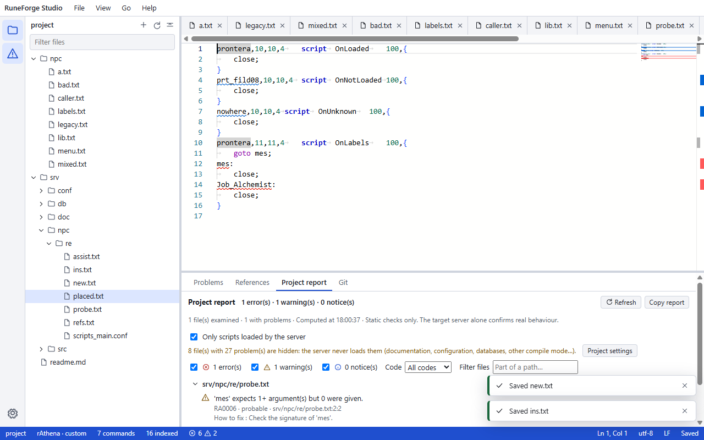

# Diagnostics

*🇬🇧 [English version](EN-Diagnostics)*

RuneForge vérifie vos scripts pendant la frappe et sur l'ensemble du projet. **Une analyse locale n'est pas une exécution du serveur** : seul votre serveur confirme le comportement réel. C'est pourquoi chaque message porte un **niveau de confiance**.

## Lire un message

Chaque problème dit **quoi**, **où**, **pourquoi** et **comment corriger**, par exemple (le libellé exact dépend de la langue de l'interface) :

> **Le label « L_Missing » n'est pas défini dans ce script.**
> `RA0002 · probable · npc/labels.txt:2:7`
> *Pour corriger : définissez le label (`L_Missing:`) dans le même NPC ou la même fonction, ou corrigez le nom.*

| Confiance | Signification |
|---|---|
| **certain** | Le code du serveur ne laisse aucun doute (par exemple un label défini deux fois dans un script) |
| **probable** | Déduit de la lecture du code du serveur ; le serveur lui-même n'a jamais été lancé pour le confirmer |
| **non vérifié** | Le serveur peut en connaître plus que les fichiers que RuneForge a pu lire (par exemple un objet présent seulement dans une base que RuneForge n'a pas vue) |

## Où apparaissent les problèmes

- **Dans l'éditeur** : soulignements et marqueurs.
- **Panneau Problèmes** (`Ctrl+J`) : le fichier courant.
- **Rapport de projet** (`Ctrl+Maj+M`) : tous les fichiers indexés, les plus graves d'abord, ouverture au clic à la position exacte, **copie en texte** pour un ticket (il ne contient jamais le contenu de vos scripts).

Pour un serveur reconnu, le rapport est **restreint par défaut aux scripts que le serveur charge réellement** ; la documentation, les bases et l'autre mode de compilation sont masqués (leur nombre est indiqué et une case les révèle).

## Référence des codes

| Code | Signifie | Faut-il un serveur ? |
|---|---|---|
| `RS…` | **Syntaxe** : chaîne ou commentaire de bloc non fermé, `;` attendu, en-tête de déclaration incomplet, type de déclaration inconnu, imbrication trop profonde… | Non |
| `RA0001` | Commande inconnue du serveur (ou fonction qu'aucun fichier ne définit) | Oui |
| `RA0006` | Mauvais **nombre d'arguments** pour une commande (d'après la table du serveur) | Oui |
| `RA0002` | `goto`, `callsub`, `menu` ou `jump_zero` vers un label qui n'existe pas | Non |
| `RA0003` | Label ou fonction locale défini deux fois | Non |
| `RA0012` | `function X;` déclarée mais jamais définie | Non |
| `RA0004` | `callfunc "X"` sans définition de `X` (index complet seulement) | Non |
| `RA0013` | `duplicate(X)` dont le NPC source est absent (index complet seulement) | Non |
| `RA0005` | Nom unique de NPC en double | Non |
| `RA0011` | Fonction globale définie plusieurs fois | Non |
| `RA0008` | **Carte** introuvable dans l'index des cartes du serveur (vérifie aussi les déclarations de NPC et les destinations de warp) | Oui |
| `RA0009` | **Objet** introuvable dans la base d'objets du serveur | Oui |
| `RA0010` | **Monstre** introuvable dans la base de monstres du serveur | Oui |
| `RA0015` | NPC déclaré sur une carte que le serveur **ne charge pas** — il l'ignore **sans aucun message** | Oui |
| `RA0014` | Label qui porte le nom d'une commande, d'une constante ou d'un paramètre — le serveur le refuse (`set_label: invalid label name`) | Oui |
| `RA0016` | Fonction appelée **par son nom** avant que le serveur l'ait chargée — le script ne se charge pas (`callfunc "Nom"` n'est pas concerné) | Oui |
| `RA0007` | Label jamais référencé (désactivé par défaut) | Non |

Le catalogue complet, avec gravité, confiance et preuve dans le code du serveur pour chaque règle, est dans [`docs/LANGUAGE_SPEC.md`](https://github.com/vazan/runeforge-npc-editor/blob/HEAD/docs/LANGUAGE_SPEC.md).

## Régler les vérifications

Dans **Paramètres › Projet**, vous pouvez :

- abaisser ou couper les alertes sur les **commandes inconnues** et les **références introuvables** (objets, monstres, cartes) ;
- activer les **vérifications entre fichiers** (`validation.crossFile`, désactivé par défaut) pour les fonctions introuvables et les noms de NPC en double — fiables seulement avec la portée d'index « scripts chargés par le serveur » ;
- choisir la **portée de l'index** : `sources` (tout ce que désignent vos motifs) ou `loaded` (seulement les scripts que le serveur charge). Indexer un dossier `npc/` entier mélange des variantes exclusives (`re/` et `pre-re/`) et crée de faux doublons ; `loaded` l'évite.

## Pourquoi une règle peut rester muette

RuneForge n'invente jamais d'information. Sans serveur rAthena reconnu — dossier de scripts isolé, projet Hercules, serveur précompilé sans `src/` — les règles propres au serveur (`RA0001`, `RA0006`, `RA0008`–`RA0010`, `RA0014`–`RA0016`) ne sont pas émises, et la barre d'état le dit.

## Ces règles sont-elles fiables ?

Elles ont été déduites de la lecture du code du serveur, puis confrontées à des **oracles indépendants** et à des **mutations volontaires** sur un vrai serveur (841 scripts chargés, plus de 9 000 NPC) : par exemple 0 fausse alerte sur 557 894 appels de commandes réels, et chacun des 4 200 appels mutés signalé au bon endroit. La trace des preuves est dans [`docs/STATUS.md`](https://github.com/vazan/runeforge-npc-editor/blob/HEAD/docs/STATUS.md) et [`docs/TEST_MATRIX.md`](https://github.com/vazan/runeforge-npc-editor/blob/HEAD/docs/TEST_MATRIX.md). La mesure porte sur un seul fork rAthena en mode Renewal ; voir [Compatibilité et limites](FR-Compatibilite-et-Limites).
