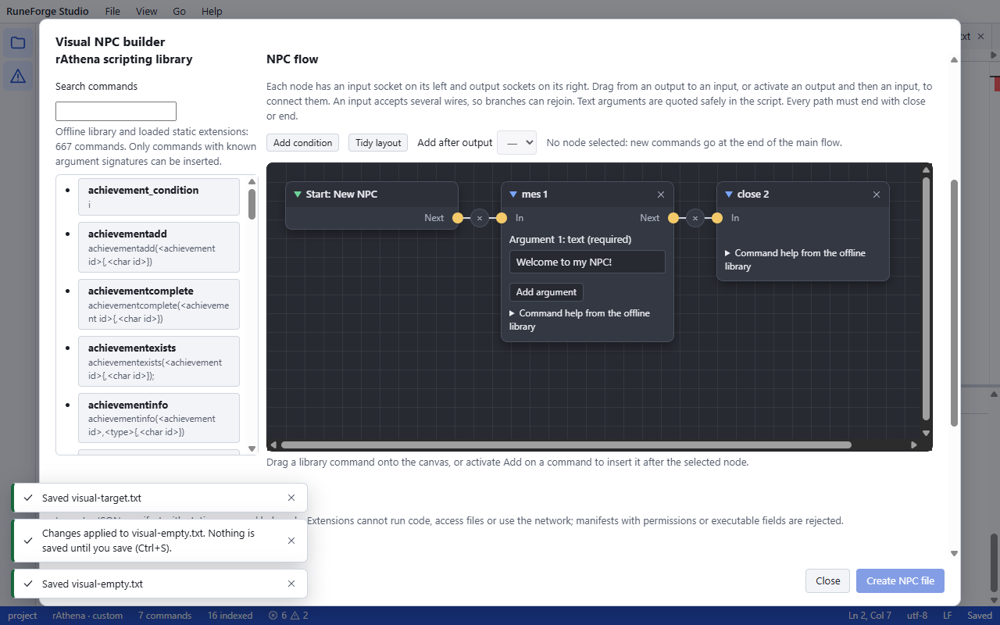
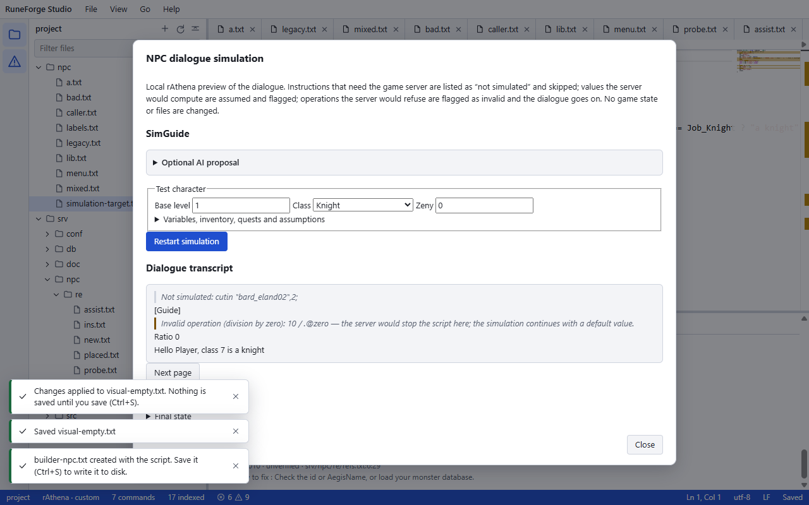

# Outils NPC

*🇬🇧 [English version](EN-NPC-Tools)*

En plus de l'éditeur, RuneForge propose cinq façons de créer ou d'inspecter un NPC sans tout saisir à la main. Elles se trouvent dans le menu **Fichier** et la palette de commandes. **Aucune ne lance votre serveur de jeu**, et aucune n'écrit un fichier avant que vous appuyiez sur `Ctrl+S`.

| Outil | Entrée de menu | Utile pour |
|---|---|---|
| [Modèles](FR-Fonctions-du-Langage#modèles-de-npc) | taper `npc-` dans l'éditeur | Des squelettes rapides |
| [Assistants de NPC](#assistants-de-npc) | Fichier › Assistant de NPC… | Portail, téléporteur, boutique, soigneur depuis un formulaire validé |
| [Éditeur visuel de dialogues](#éditeur-visuel-de-dialogues) | Fichier › Éditeur visuel de dialogues… | Modifier par blocs le dialogue d'un NPC existant |
| [Constructeur visuel de NPC](#constructeur-visuel-de-npc-graphe-de-nœuds) | Fichier › Créer un NPC avec l’éditeur visuel… | Créer un nouveau NPC en reliant des nœuds |
| [Simulation de dialogue](#simulation-de-dialogue) | Fichier › Simuler le dialogue d’un NPC… | Jouer un NPC localement pour voir son dialogue |
| [Génération par IA](#assistance-ia-facultative) | Fichier › Générer un NPC à partir d’un prompt… | Ébaucher un script depuis un prompt (facultatif) |

## Assistants de NPC

Quatre formulaires rAthena : **portail de téléportation**, **PNJ téléporteur**, **boutique**, **soigneur**.

- Remplissez les champs ; le **script est produit en direct** à droite.
- Chaque champ dit ce qui ne va pas (nombre, nom de carte, sprite, liste d'objets…). **Aucun script n'est produit tant qu'il reste une erreur.** Un avertissement (prix à 0, prix démesuré, objet en double) n'empêche rien.
- Une **vérification locale** — la même analyse que l'éditeur — annonce ensuite les problèmes du script produit.
- Trois sorties explicites :
  - **Copier** dans le presse-papiers ;
  - **Ajouter au fichier ouvert** — ajouté **à la fin** du fichier affiché, annulable par `Ctrl+Z` ; écrit sur le disque seulement quand vous enregistrez ;
  - **Créer le fichier** — crée un nouveau fichier (nom modifiable ; un fichier existant n'est jamais écrasé) contenant le script, à enregistrer avec `Ctrl+S`.

Le serveur ne charge un fichier de script que si l'un de vos fichiers `scripts_*.conf` le cite — RuneForge ne modifie jamais ces fichiers. Les textes proposés sont en anglais simple (ASCII), car l'encodage des textes en jeu dépend de votre serveur et de votre client. Contrôle de qualité : 1 600 scripts générés au hasard contre les données d'un vrai serveur n'ont produit aucun diagnostic, et 980 saisies invalides sur 980 ont été refusées sur le bon champ. Aucun script produit n'a été chargé par un serveur en marche.

## Éditeur visuel de dialogues

Ouvre le NPC sous le curseur et montre son dialogue sous forme de **blocs** (`mes`, `next`, `close`, branches `if`). Les instructions qu'il ne comprend pas restent **verrouillées** et sont conservées telles quelles. Vous relisez une comparaison, appliquez les changements au document, puis enregistrez. Il travaille sur un NPC à corps fermé dans le fichier courant ; les boucles, `select` et `goto` ne s'éditent pas encore comme des blocs.

## Constructeur visuel de NPC (graphe de nœuds)

Un éditeur de nœuds qui **crée** un nouveau NPC :

1. **Glissez** une commande de la bibliothèque rAthena hors ligne sur le canevas (ou activez-la pour l'insérer après le nœud sélectionné).
2. **Reliez** les nœuds : glissez d'une **prise de sortie** (bord droit d'un nœud) vers la **prise d'entrée** (bord gauche) d'un autre nœud. Le script suit les fils, pas la position des nœuds.
3. Un nœud **condition** a deux sorties, **Alors** et **Sinon** ; plusieurs fils peuvent entrer dans une même entrée : des branches peuvent donc se rejoindre.
4. Chaque chemin doit finir par `close` ou `end`. Un nœud ou une sortie non reliés bloque la création, avec une explication ; un fil qui ferait boucler le flux est refusé.
5. Le script produit est analysé localement avant la création d'un nouveau fichier de projet **non enregistré**.

Au clavier seul : activez une prise de sortie, puis une prise d'entrée ; `Suppr` sur une sortie la débranche ; `Échap` annule une connexion en cours.

Seules les commandes dont la signature des arguments est connue sont disponibles. Le constructeur peut aussi charger un **manifeste d'extension JSON temporaire** de noms de commandes, signatures et aides statiques — il n'accepte **ni code ni permission**, et rien n'est conservé. Pas encore pris en charge : relire un script *existant* sous forme de graphe, `select`/`menu` à plusieurs sorties, `goto`, boucles, annuler/rétablir.

## Simulation de dialogue

Joue le NPC sous le curseur dans un aperçu local — aucun serveur, aucun fichier ni état de jeu touché.

- Exécute les variables de toute portée (une variable jamais écrite vaut 0, comme sur le serveur), les constantes, les tableaux, `switch`, les boucles, `callsub`, `callfunc` (y compris vers les fonctions d'autres fichiers du projet que l'index connaît), les commandes de quêtes et d'inventaire, `input` et `close2`.
- Choisissez le **personnage de test** par le **nom de sa classe** (les noms que le serveur donne, comme *Knight*, *High Priest*, *Rune Knight* — en anglais dans les deux langues d'interface), son niveau et ses Zeny. Sous *Variables, inventaire, quêtes et hypothèses*, fixez l'état du personnage ; la graine du hasard rend une partie reproductible.
- **Elle ne s'arrête jamais sur une erreur.** Tout ce que le serveur refuserait (division par zéro, argument absent, label inexistant…) apparaît comme une ligne *Opération invalide* avec sa raison, et le dialogue continue avec une valeur par défaut. Les instructions qui exigent le serveur de jeu (`warp`, `cutin`, `specialeffect`…) sont listées comme *Non simulé* et ignorées ; les valeurs que le serveur calculerait sont *supposées* et signalées.
- Seules les limites de ressources (boucle sans fin, texte démesuré) interrompent une partie.

> **Une partie menée à son terme ne prouve pas que le NPC fonctionne sur le serveur.** Les lignes « Non simulé » et « Résultat supposé » sont la liste de ce qui n'a *pas* été calculé. Après une opération invalide, le vrai serveur aurait arrêté le script.

Mesuré sur un serveur de référence : les 9 211 NPC, 73 688 parties, 0 défaut interne ; 196 648 parties supplémentaires sur des scripts abîmés au hasard n'ont levé aucune exception. Les événements (`OnTimer`, `OnTouch`, `donpcevent`) ne sont pas déclenchés — seul un clic sur le NPC est joué.

## Assistance IA facultative

Deux fonctions facultatives utilisent un point d'accès **compatible OpenAI** que vous configurez dans **Paramètres › Modèle IA** (URL de base, par exemple `http://127.0.0.1:8000/v1`, et nom du modèle) :

- **Proposition IA** (dans la fenêtre de simulation) : suggère une révision du NPC affiché.
- **Générer un NPC à partir d'un prompt…** : ébauche un nouveau NPC à partir d'un prompt seul.

Garde-fous :

- Rien n'est envoyé sans **consentement explicite** ; le source exact du NPC (mode proposition seulement), le prompt, l'URL et le modèle sont affichés d'abord.
- Une destination hors de la boucle locale exige une **confirmation distincte**. Le `http` simple n'est accepté que pour la boucle locale ou une adresse IPv4 privée et **n'est pas chiffré** — à utiliser seulement sur un réseau de confiance.
- La clé API est conservée **en mémoire seulement**, jamais enregistrée, et envoyée comme jeton Bearer.
- Les suggestions sont validées localement et affichées **à côté de l'original**. En approuver une **crée un fichier séparé non enregistré** ; votre document n'est jamais remplacé.

Aucun fournisseur d'IA réel n'a encore été vérifié ; les tests utilisent un transport simulé.
